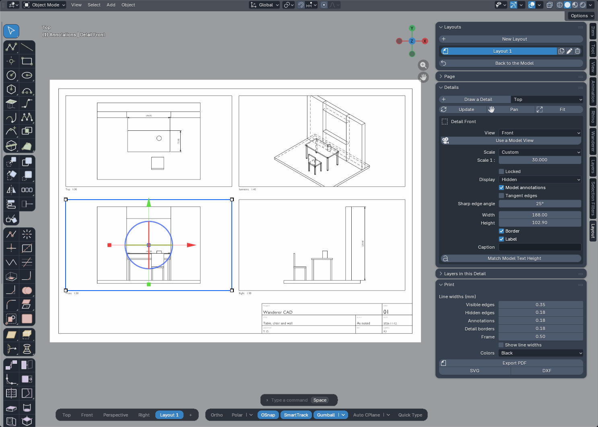
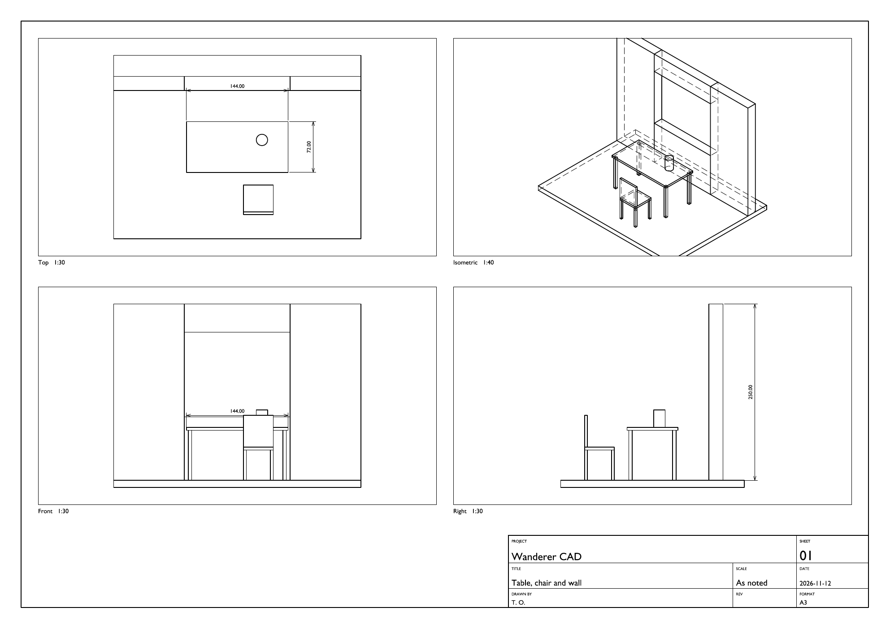

# Wanderer CAD 2.96.125 — what's new since 2.96.124

2.96.125 adds **Layouts**: paper sheets with detail views of the model at scale, a title block, dimensions and notes in paper millimetres, and vector **PDF / SVG / DXF** export. It also answers user feedback: object snaps are easier to find and can be used **one shot** as in Rhino, **Grid Snap** joins the mode bar, the bottom bars **fit in a split view**, the **Z lock works on Polyline**, and the commands typed on the command line no longer do nothing in silence. Nothing else changes in the modeling tools.

## Layouts

- **Layout** (`layout`, the toolbar button at the end of the annotation tools, the `+` of the view tabs, or the **Layout** tab of the sidebar): name, paper (A5 to A0, Letter, Legal, Tabloid, ANSI C to E, Arch A to E, or a custom size), orientation, margin, title block, and none, one or four details (Top, Front and Right aligned at the same scale, plus an isometric view).
- A layout is a **tab next to the view tabs**. Click it to go to the sheet, click a view tab to come back to the model with the view you had. Double-click the tab to rename it. Layouts can be duplicated and deleted from the panel.
- On the sheet **1 unit is 1 mm of paper**. Everything you draw there with the usual tools (lines, text, hatches, dimensions) is annotation at paper size. What you draw is black by default, like colour 7 on a white background, and the previews of the tools and the crosshair are dark on the paper.
- **Title block**: project, title, drawn by, date, sheet number (01, 02, 03... in the order the layouts are created), revision, format, and the scale — the common scale of the details, or "As noted" when they differ.
- **Zoom Extents** (`ze`) on a layout frames the whole sheet between the toolbar and the sidebar.

## Details

- **Detail** (`detail`, in the drop-down of the Layout button): two corners on the sheet. A detail shows the model in a view — Top, Front, Right, Left, Back, Bottom, four isometric views, or a copy of the current model view or of a named view (perspective included) — at a scale: 1:1 to 1:1000, enlargements, or any typed value such as `1:30`.
- **Display**: wireframe, hidden lines removed, or hidden lines dashed. Sharp edge angle and tangent edges are per detail.
- **Layers per detail**: hide a layer in one detail only.
- Dimensions, text and hatches of the model can be shown in the detail, or not.
- **Pan Detail** (`dpan`): drag the model inside the frame; the wheel goes to the next standard scale. **Fit** centers the model and picks the largest standard scale that fits. A detail can be **locked**.
- Move a detail with the Gumball; its scale handles resize the frame, the drawing stays at scale.
- Details are redrawn when the model has changed and you come back to the layout, and with **Update Details** (`regen`).
- A label under each detail gives the view and the scale, with an optional caption.

## Dimensions on the sheet

- The dimension tools work on the sheet and snap to the linework of the details. A dimension placed on a detail gives the **length of the model** (paper length x scale); its text is in paper millimetres (2.5 mm by default) whatever the scale.
- It is **attached to its detail**: move the detail, pan it or change its scale, and the dimension goes back onto the same points of the model, with the same value. Copy a detail with its dimensions and the copies are attached to the copy. Delete a detail and its dimensions go with it.
- A dimension placed outside any detail measures the paper.
- Each layout has its own dimension style; dimensions are black by default.

## Export

- **Export PDF** (`pdf`, `print`, `plot`): vector, at the exact paper size, one page per layout (the current one or all of them). Print at 100 % and the drawing is at scale. Line widths are in millimetres and set in the panel: visible edges 0.35, hidden edges 0.18, annotations 0.18, detail borders 0.18, frame 0.5. Colours: black, or the colours of the layers.
- **Export SVG** (millimetres) and **Export DXF** (paper millimetres, layers VISIBLE / HIDDEN / TEXT / FRAME..., HIDDEN linetype) for Illustrator, Inkscape, AutoCAD, Rhino.

## Good to know

- A detail is a line drawing computed from the meshes of the model: silhouettes, sharp edges and borders. There are no shaded or rendered details.
- Measured on the test machine: reading a model of one million faces takes about 1.2 s, then about 3 s per detail with hidden lines. Panning a detail or changing its scale is immediate (the projection is kept).
- Text in the PDF is drawn as outlines: it prints exactly, but it cannot be searched or selected.
- A dimension is attached to points of the view, not to the objects: if the model itself changes, check the dimensions placed on the sheet.
- A perspective detail has no single scale: dimensions placed on it measure the paper.
- After you delete a detail with a Blender command other than `Delete` / `X` (the Outliner, a menu), its linework and dimensions are removed a moment later, as a second undo step.

## Under the hood

- Two new modules, `layout_engine` (projection, hidden lines, clipping, PDF / SVG / DXF writers — no Blender UI code) and `layout` (sheets, details, panels, commands). The add-on is a package of **44 modules**.
- A layout is a Blender scene in millimetres; a detail is a rectangle whose linework is generated children.
- Maintenance done outside a command (after a Blender command) always gets its own undo step, and waits after an Undo. This matters: Blender crashes when objects are created or deleted between two undo steps and the user then presses Ctrl + Z. It happened during the tests of this version, and a test now covers it.

## Mode bar

- **OSnap has an arrow**, like Polar and Gumball. It opens the list of object snaps (End, Near, Point, Mid, Cen, Int, Perp, Tan, Quad, Knot, Vertex, Project, Disable, All On, All Off). The snap boxes are still in the status bar at the bottom left; a user had not seen them there.
- **One-shot object snaps**, as in Rhino. While a command asks for a point, hold **Shift** with the mouse over the snap boxes of the status bar: they all clear. Click the ones you want, one or several: only they act for the next point, whatever is checked, and even if snaps are switched off with F3 or `S`. Release Shift without clicking and the boxes come back as they were. The checked snaps return as soon as the point is placed, or when the command ends. Shift + click also works in the OSnap menu. The OSnap button reads `OSnap: End+Mid` meanwhile; click it, or click a box without Shift, to give up.
- **Grid Snap** (`F9` while drawing), to the left of Ortho, off by default: the free cursor lands on the grid of the construction plane. The arrow sets the **snap spacing**: 10 cm by default in every scene (written 100 mm, 10 cm or 0.1 m according to the unit of the scene), 0.1 to 1000 units from the menu, or a custom value. The spacing is a real length: changing the unit shown by the scene does not change it. Object snaps and typed values win over the grid. With Ortho, an axis lock or a tracking line the point stays on the line and lands on the grid along it; with Polar the length moves by whole steps. The heights of boxes, cylinders and extrusions move by whole steps too. A cross marks the grid point where the click will land.
- **Narrow views.** The view tabs and the mode bar now always stay side by side at the bottom, with the command line above them; the tabs no longer move to a middle row. As soon as the two no longer fit side by side in full, they switch to a compact form: initials for the views (Top Front Perspective Right becomes T F P R +) and icons for the modes. The names stay in the tooltips. In a very narrow view the icons take two rows, then only the active view and `+` (whose menu lists every view) stay next to them. Nothing slides under the toolbar or the sidebar any more.
- **Command line in a narrow view.** In a wide view nothing changes: its width follows its text, as before. In a narrow view (icons and initials) it takes a fixed width, exactly that of the bars below it: the mode bar, or the view tabs and the mode bar together when they share a row. It never sticks out beyond them; a longer message is shortened and its key hints move to a second row.
- **Mode bar in icons only, if you prefer.** New preference *Mode bar: icons only* (Preferences > Add-ons > Wanderer CAD > Command line), off by default. When it is on, the mode bar at the bottom right always shows its icons, even in a wide view: it takes less than half the room. The view tabs keep their full names as long as they fit next to the icons, and the command line keeps its usual width. In a narrow view nothing changes. When it is off, the buttons show their names and only turn into icons when the view gets narrow, as before.
- **Smaller bars.** The command line, the view tabs and the mode bar are 10 % smaller at the 100 % setting of *Command bar size*: 100 % now looks like the former 90 %. If you had lowered that preference to 90 %, set it back to 100 %.

## Fixed

- **Z lock on Polyline.** Pressing `Z` after the first point did nothing, although the prompt announced `X/Y/Z: lock axis`: a polyline was kept in its construction plane. Polyline, Control Point Curve, Interpolate Curve and Surface from Corner Points now leave the plane along a locked axis: press `Z`, then click, or type the height (the three curve tools). In a top view the mouse cannot show a height: type it. The next points are drawn at the height of the last one. Hovering an object snap while the axis is locked goes up to the height of that point. Flat shapes (Rectangle, Circle...) are unchanged and their prompt now lists only the two axes that work.
- **`dupborder` + Enter did nothing.** Typed on the command line with nothing selected, Duplicate Border, Pipe, Intersect, Merge All Faces, Unroll Surface and Rebuild Surface only wrote a message in Blender's status bar. They now behave like Join: with a selection they run at once, without one the tool is armed and the command line says what to click, then Enter. Section, Contour and Orient arm their tool the same way; Extract Surface and Duplicate Edge start at once.
- **When one of these commands cannot do anything, it says so in the command line**, in colour, for a few seconds, and as a Blender warning: "Duplicate Border: a closed solid has no free border · use Duplicate Edge (DupEdge) to copy one of its edges", "Intersect: the selected objects do not intersect", "Merge All Faces: no coplanar faces to merge"...
- **These eleven commands were listed twice** in the command line suggestions. There is one entry each now, with the same aliases.
- **Intersect, Section and Contour dropped every curve that was not closed.** Two flat surfaces crossing each other gave "the selected objects do not intersect", and a section through an open surface gave nothing. Open curves are now created. Found while writing the tests for this release; closed results are unchanged.
- **The mode bar was more transparent than the command line and the view tabs.** Blender switches alpha blending off after every text it draws. The mode bar is drawn after the names of the view tabs: its background was written without blending, at 93 % opacity, while the two other bars end up fully opaque, so the model showed faintly through it. The same happened to the tooltips of the bars, to the command line while a command is typed (it is drawn after its list of suggestions), and to the thin line between a button and its arrow, which showed as a bright stroke. Blending is now restored before every shape: the three bars have exactly the same background, and the icons are properly smoothed.
- The tooltip of the Auto CPlane arrow showed the text of the Gumball menu.

## Gumball and object snaps

- Nothing changed: the Gumball follows object snaps when **Snappy Dragging** is chosen in the Gumball menu (arrow next to Gumball); the default is Smooth Dragging. The tooltips of the Gumball button and of its arrow now say so.

---

# Wanderer CAD 2.96.124 — what's new since 2.96.123

2.96.124 adds **eleven commands**, **Gumball handles to extrude and cut**, **PushPull on curved faces**, **pasting coordinates**, tracking along the **extension of a segment**, safer **Booleans**, and it fixes several problems found while remodeling a real piece of furniture with the mouse and the keyboard: the **Napoleone** coffee table, designed by **Claudio Salocchi for Acerbis** (see the README).

## New commands

They are in the toolbar, in the Wanderer menu and on the command line.

- **Pipe** (`pipe`): a round tube along curves, with mitred corners on polylines and optional caps.
- **Intersect** (`int`): the curves where surfaces and solids meet, and points where curves cross.
- **Section** (`sec`): cuts the selected objects with a plane given by two points.
- **Contour** (`contour`): evenly spaced section curves (base point, direction, spacing). At most 2000 planes.
- **Extract Surface** (`extractsrf`): click faces of a solid to detach them (`C`: copy).
- **Duplicate Border** (`dupborder`) and **Duplicate Edge** (`dupedge`): curves from the free borders of a surface, or from the edges you click.
- **Merge All Faces** (`mergeallfaces`): merges neighbouring coplanar faces after Booleans or PushPull.
- **Unroll Surface** (`unroll`): flattens a developable surface (cylinder, cone, folded plates) at true length. Double-curved surfaces are refused.
- **Rebuild Surface** (`rebuildsrf`): rebuilds a surface made of a grid of quads with the point counts you choose.
- **Orient** (`orient`): two reference points onto two target points (`D`: also scale, `C`: copy).

## Gumball

- **Extrusion sphere** on the arrows where an extrusion makes sense: it extrudes the curve, the flat surface or the selected faces (`Shift`: both sides).
- **Cut handle** (a short line next to the sphere): a closed flat curve cuts the solids on its way; with `Ctrl/Cmd` it adds to them. On a selected flat face it pushes or pulls like PushPull.
- Drag the handle, or click it, type the distance and press Enter.
- The cut now also works on an object that holds a solid *and* a loose surface (for example a duplicated face): the closed parts are cut, the rest is left as it is. An object with no closed part gives a message that names it.

## PushPull

- Works on **curved faces**: the face is offset along its normals. A cylinder of radius 1 pulled by 0.5 becomes a cylinder of radius 1.5, and the caps follow. It also works on a sphere, the wall of a hole, a dome on a box, a rounded end.

## Typing and pasting

- **Enter repeats the last value** typed in a tool (radius, distance, height...). A preference turns it off.
- **Ctrl/Cmd + V** during a command enters the numbers or coordinates of the clipboard as if they were typed: `12.5`, `#0,0`, `@10,0`, `@10<45`. Several points separated by spaces or line breaks are entered one after the other, so a whole polyline can be pasted at once.
- `#` and `@` typed with AltGr (French, German... keyboards) or Option (Mac) are accepted.

## Tracking

- **SmartTrack follows the extension of a segment**: start on the end of a curve or an edge (or hover it for half a second), then move near the line that continues its last segment. The cursor locks on it, and on its crossing with the X / Y / Z lines of other points.

## Booleans

- Every result is checked: closed solid, coherent volume, no zero-thickness sheet. If a solver fails the next one is tried; a warning is shown when no solver gives a verified solid.

## Fixed

- **Fillet Curve, Chamfer Curve and Divide** read typed values in metres whatever the unit of the scene: typing `6` in a millimetre scene gave a 6 m radius. Typed values and the status text now use the unit of the scene (mm, cm, m, inches...).
- **Dimensions placed by an older version stopped following the dimension style.** They store the tool under its class name (`DESSIN_OT_cotation`) while the current code only looked up the command name (`dessin.cotation`), so changing decimals, units, arrow size or text height silently left them as they were. Both spellings are read now, and an old dimension rebuilds like any other.
- **Auto CPlane** is off by default again.

## Under the hood

- The add-on is now a **package of 42 modules** instead of one file. It is still one extension and installs the same way.
- 60 regression suites, with new ones for the new commands, the Gumball handles, units, pasting, tracking and the rebuilding of old dimensions.

## How it was tested

- **Automated:** 60 suites out of 60 pass. No mouse move above 16 ms out of 11,232 measured.
- **With the real mouse and keyboard, in Blender 5.1.1 on Windows:** the complete modeling session shown in the README (Polyline, Fillet Curve, Offset, object snaps, Join, Extrude Curve, Box, Gumball cut by dragging and by entering a value, Fillet Edge, Circle, Copy, Mirror, Stretch, Dimension). Numbers and coordinates were entered with Ctrl/Cmd + V. The finished parts were measured: every one is a closed solid and the overall sizes match the reference model. The **Angular Dimension** was then placed by hand on the fold of the "V" and reads 90.00 degrees, and the height dimension was placed again from the underside of the base plates (355.5 mm, not 375.16 mm from the floor).
- **Not tested by hand yet:** Pipe, Intersect, Section, Contour, Extract Surface, Duplicate Border / Edge, Merge All Faces, Unroll, Rebuild Surface, Orient and PushPull on curved faces (automated tests only), and `#` / `@` typed with a real AltGr key. Mac and Blender 4.2 to 5.0 were not re-tested for this release.

---

# Wanderer CAD 2.96.123 — what's new since 2.96.122

123 adds **hatching**, **blocks**, more **dimension** tools, a set of Rhino-style **curve and surface** tools, **sub-object selection**, a **Mac** pass, two new looks (**Ghost** theme, **Target** icons) and a lot of work on **precision, stability and speed in big scenes**.

It is also the release where the add-on moves from beta to **stable**: every tool was run again for geometric precision, Undo/Redo, odd scenes and speed (see "How it was tested").

## New tools

**Hatch**
- **Hatch:** fills closed planar curves with a pattern. Curves inside another one become holes. Ten patterns (Solid, Hatch 1–3, Dash, Grid, Grid 60°, Plus, Squares, Brick), with scale, rotation and spacing.
- **Hatch Region:** click inside an area closed by curves.
- **Hatch Base Point**, **Match Hatch** (copy pattern, scale and rotation from the hatch you clicked last), **Hatch Boundary** (curves on the outline and the holes), **Explode Hatch** (curves; a solid hatch becomes a planar surface).
- A **Hatch panel** in the Wanderer tab.

**Blocks**
- **Block:** select objects, click a base point. Every copy of the block updates together.
- **Insert Block** (with scale and rotation), **Block Edit** / **Close Block Edit** (edit in place, all copies follow), **Select Block Copies**, **Delete Block**, and **Explode** also works on a block.
- A **Blocks panel** in the Wanderer tab.

**Dimensions and annotation**
- **Continue Dimension** (continue or baseline), **Ordinate Dimension**, **Arc Length Dimension**, **Move Dimension Line** (on a dimension already placed).
- **Center Mark** on circles, arcs and ellipses (`D`: small cross or center lines).
- The text of the selected dimension can be edited in the panel; `<>` stands for the measured value (`4x <>`, `<> TYP`).

**Curves**
- **Rebuild Curve** (point count and degree), **Simplify Curve** (within a tolerance), **Change Degree**.
- **Insert Control Point** / **Remove Control Point**.
- **Match Curve** (tangency or position) and **Blend Curve**.

**Surfaces**
- **Network Surface**, **Fillet Surface**, **Chamfer Surface**, **Extend Surface**, **Split at Isocurve**.
- **Untrim** and **Untrim Holes**.

**Extrude Curve** (this tool was called "Extrude Straight") now has **B** both sides, **T** tapered (Tab for the angle) and **P** to a point.

## Selection

- **Ctrl/Cmd + Shift + click** selects a vertex, an edge or a face under the cursor and goes into Edit Mode with it selected, without pressing Tab. **Ctrl/Cmd + click** removes it; **Esc** goes back to Object Mode.
- **Ctrl/Cmd + Shift + drag** (box or lasso) selects the visible vertices of every mesh in the area, or the points of every curve, and puts those objects into Edit Mode together. Blender cannot edit a mesh and a curve together: if the area holds both, the type with the most points in the area is used.
- **Move, Rotate and Scale work on curve points** in Edit Mode: moving one vertex of a polyline no longer moves the whole object.

## Workflow

- **C closes** a polyline or a control point curve, like the Close option in Rhino and AutoCAD.
- **F3** switches object snaps on and off.
- **Ctrl/Cmd + Z during a command** removes the last point (it used to undo the previous operation in Blender while the command was still running).
- **PushPull on curves:** click inside closed curves to make a surface and pull it. Curves drawn on a face cut it first (inner area and outer ring).
- **Offset Edge:** a circle or an arc is offset as a real circle or arc (radius r ± d), not a polyline. A closed outline offset inside a face splits that face, so PushPull can raise the ring into a wall.
- **Explode** now works like Rhino: a solid separates into its smooth surfaces. A cylinder gives 3, a box 6, a sphere stays whole (before, every facet became an object: 34 for a 32-sided cylinder). It also explodes blocks.
- **Quadrant snap** (0°, 90°, 180°, 270° of a circle or arc) is **on by default** and works on circles and arcs drawn outside Wanderer too (Blender, imports, NURBS), with their center.
- **Circles and arcs** are built with one Bézier segment per 45° at most: a circle has 8 control points, like in Rhino. The gap to the true circle is 0.0004 % of the radius (4 µm on 1 m) instead of 0.027 % (0.27 mm).

## Mac

- **⌘ acts as Ctrl** in every Wanderer selection and tool gesture (unless ⌘ is set as the emulated middle button). Help texts read **Ctrl/Cmd**.
- Fixed the navigation gizmo click zone on Retina screens, which covered the upper-right quarter of the viewport.

## Themes and icons

- New theme **Ghost** (black with signal red). It switches the icons to **Target**.
- Icon styles: **Atlas** (one color per tool family), **Blueprint** (white and blue), **Ochre** (white and ochre) and the new **Target** (dimmed grey, only what the tool creates lights up in red). Saved preferences are kept.

## Big scenes and speed

- **Snap budget** (Preferences > Performance and precision, 2 million points by default, 0 = no limit). Lighter objects stay ready; very dense ones (over 8,000 vertices) are read in detail when the cursor slows down over them. In a 10,000-object city scene: first launch of a tool 2.6 s → 0.65 s, snap memory 1.25 GB → 0.47 GB. In the whole-city view, an object smaller than about 48 px on screen is read only after you zoom in.
- **Snaps follow your edits:** snap data is refreshed when geometry actually changes, and cleared on Undo/Redo and when a file is loaded.
- **Edit Mode on dense meshes:** the object being edited keeps all its vertices (up to 120,000) for snapping. Before, only some of them could be snapped.
- **Open curves chained into outlines** (Planar Surface and the tools built on it): 5,000 loose segments take 0.1 s instead of 82 s, with the same result.
- **Curve quality** (Preferences): Draft / Normal / Fine / Very fine = 48 / 96 / 192 / 384 sides per circle when curves become meshes. Normal is the default.
- **Far from the origin:** Blender stores coordinates with about 7 digits. Beyond roughly 500 m the step between two positions exceeds 0.05 mm. Wanderer now says so once per file when you place a point there (Preferences: can be turned off). Working near the origin keeps full precision.

## Fixes

- **Offset Edge on a face** (reported on GitHub): see above, the ring now splits the face.
- **Edge picking** in Fillet Edge, Chamfer Edge and Offset Edge skips edges hidden behind a surface, such as the original curve under a solid.
- **Ctrl/Cmd + Shift + click in Edit Mode** no longer runs Blender's shortest-path selection.
- **Move on a polyline vertex** moved the whole object (see Selection).
- **Quadrant** points of circles and arcs were not found at all (Midpoint, Near or nothing): see Workflow.
- **Dense meshes in Edit Mode**: a click on a vertex could find no snap (see above).
- **Navigation gizmo** on Retina screens (see Mac).

## How it was tested

- **More than 40 regression suites** replay the tools in a headless Blender with the same mouse and keyboard events a user would send, and **measure** the result: coordinates, lengths and volumes against exact values, Undo/Redo states compared field by field for every tool, every tool on empty scenes, wrong selections and extreme typed values (97 tools × 7 scenarios × 6 variants: no exception), and time per mouse move. They are in the `tests/` folder (`python scripts/run_tests.py`).
- Tested on **Blender 5.1 and 5.2**. The declared minimum is 4.2.
- Tried by hand on a Mac for the SubD tools, Offset Edge / PushPull and Ctrl/Cmd + Shift + click, and run on a 10,000-object city scene in Blender on Windows.

## Good to know

- To update: **uninstall the previous version, install the new zip, restart Blender.**
- **Copy** on curve points in Edit Mode, and the move ghost for curve points, are not available yet.
- Ctrl/Cmd + Z inside a command and the Boolean tools were tested with simulated events, not yet by hand on every platform. Reports are welcome.
- Not in yet (Rhino commands people ask for): Pipe, Intersect, Contour/Section, ExtractSrf, Unroll, RebuildSrf, Orient, DXF export.
