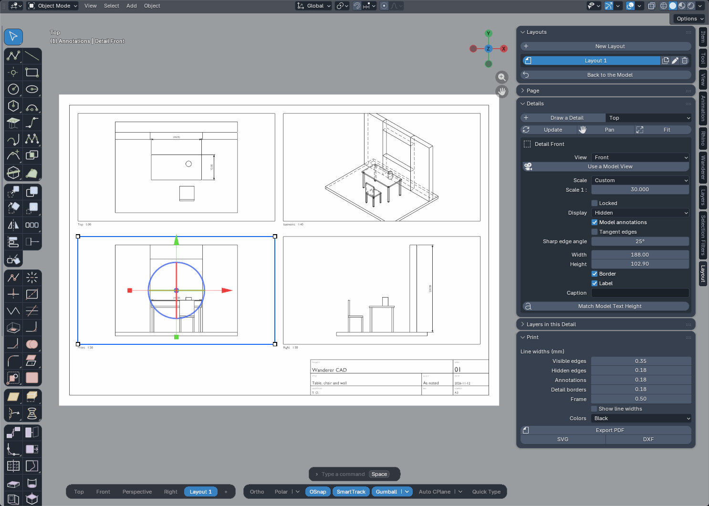
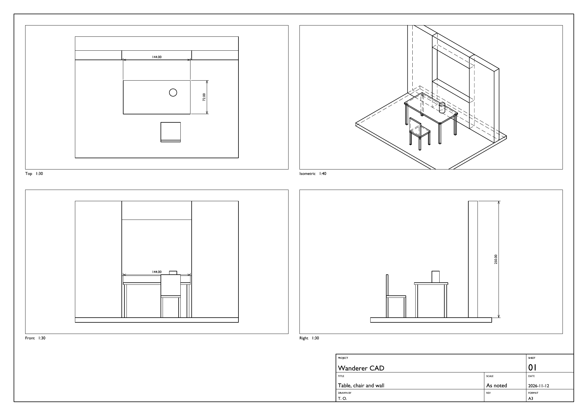

# Wanderer CAD 2.96.129 — what's new since 2.96.128

## The Gumball is now the Gizmo

- **The Gumball is renamed Gizmo everywhere** (status bar button, its menu, Relocate / Reset / AutoReset Gizmo, Preferences > Gizmo, the Gizmo panel of the sidebar, tooltips), to match Blender, which calls these handles gizmos. It works exactly as before; your settings are kept.

## Walk

- **Orient** and **Orient 3 Points** are now in the drop-down menu of **Align**.

- **New Walk tool**, in the toolbar right next to Select, in Object and Edit mode (command line `walk`): a shortcut to Blender's own **Walk Navigation** (Shift+`). Click in the view to walk. It is the same function, so its speed, view height, gravity and mouse sensitivity are set in Preferences > Navigation > Walk.
- Its icon is a walking figure in the colour of the Transform tools (from the "directions_walk" symbol of Google's Material Symbols, Apache 2.0: see THIRD_PARTY_NOTICES.md in the add-on).
- **A redrawn toolbar icon now shows up as soon as the add-on is updated**: Blender keeps an icon in memory under its file name until it restarts, so each icon file name now carries a fingerprint of its drawing (old versions are removed). Before, a new icon only appeared after restarting Blender.
- Toolbar icons can now use quadratic curves and plain fills without outline; a closed shape whose last point repeats the first is no longer left partly empty.

## Hide, Isolate, Unisolate, Show (as in Rhino)

- **Unisolate**: shows back only the objects hidden by **Isolate**; objects you had hidden with **Hide** before stay hidden. Two Isolates in a row: Unisolate shows back everything both hid. Command line `unisolate` / `uniso` (and `UNISOLATEOBJECTS` from an AutoCAD alias file).
- **Show** (formerly Show All): shows every hidden object, hidden with Hide or by Isolate. Command line `show` / `showall`.
- **Right-click menu**: **Isolate** (with a selection) and **Unisolate** (when Isolate has hidden objects, even with nothing selected). *Show All*, *Local View* and *Quit Local View* are no longer in the menu (Local View stays on the `/` key and the command line).

## Hatch: changing the pattern of a hatched shape

- **Hatching a shape again replaces its hatch.** Select the shape, pick another pattern, Hatch (or click inside it with Hatch Region): the hatch already filling exactly that area takes the new pattern, scale and rotation, and keeps its layer, spacing and base point. Before, a second hatch was stacked over the first one and you had to delete it. Another area (a neighbour, the hole of the shape, the shape without its hole) still gets its own hatch; a hatch moved away from its shape or hidden is left alone.
- **Tool header of Hatch / Hatch Region**: when a hatch is selected (the one just made, or one clicked), the pattern, scale and rotation shown are those of that hatch, and changing them changes it at once. With curves selected, the header shows the settings of new hatches, as before.
- The last pattern, scale and rotation chosen on a hatch become those of the next hatches.
- A closed curve drawn twice at the same place (the outline left by the **Boundary** option, a curve copied in place) counts once: a second click with Hatch Region no longer loses the holes of the shape.

## Drafting commands from AutoCAD

- **Boundary** (`bo`, `boundary`, `bpoly`; Annotation tools, Wanderer menu): click inside an area to create a closed polyline around it, like BOUNDARY. The area may be closed by lines that only **cross each other** (walls drawn as separate lines overlapping at the corners, a partition stopping in the middle of a room): they are cut at their crossings, the loose ends are ignored, and lines lying on top of each other are merged. The islands inside the area (columns, furniture) get their own closed polylines; **D** switches to the outer contour only. The area under the cursor lights up before you click, and the command stays active to pick room after room.
- Boundary and its relatives hold up on real plans: a partition whose end only touches a wall (T junction) closes the room whatever the rotation of the plan or its distance from the origin, and **areas are exact far from the origin** (a contour measured 50 km away lost up to 0.1 % of its area, in Area / Perimeter too).
- **Area / Perimeter: Inside.** Press D once: click inside an area (same detection as Boundary) to read its area, islands deducted, and its perimeter, without drawing the contour first. The area lights up and its value follows the cursor; the result is copied to the clipboard. D again: Selection, as before.
- **Hatch Region also works with crossing lines**: when no single closed curve surrounds the point, the area closed by the crossing lines is hatched (with the islands as holes), like HATCH with a pick point.
- **Break** (`br`, `break`, `breakatpoint`; Modify tools): click a curve at the first break point, then the second point: the part between them is removed, to open a door or a window in a wall line. On a closed curve (a rectangle, a circle) the shorter part is removed and the curve stays one piece. **D: At Point** cuts a curve in two without a gap, like BREAKATPOINT (on a closed curve: it opens there); **Enter** after the first point does the same. Snaps work (an intersection gives the exact point), circles and arcs stay true arcs, and the second piece keeps the layer, color and linetype. The command stays active; each break can be undone on its own.
- **Match Properties** (`ma`, `matchprop`; Modify tools): click the source object, then click the objects that should take its layer, color, linetype, print width, material, and text settings (size, font, alignment) or hatch settings (pattern, scale, rotation). With objects already selected, click the source and they all take its properties at once. Which properties are copied is chosen in the tool settings at the top of the view. Clipping planes are never changed. Dimensions keep their own layer.

## Linetypes

- **Each layer has a linetype** (Continuous, Dashed, Hidden, Center, Dash Dot, Phantom, Dot), in *Layers > Print Settings*, next to its print width, and **each curve can have its own** (*By Layer* by default): right-click > **Linetype**, or the button under the table. Curves and lines of the layer are drawn with dashes in the 3D views; solids, dimensions, texts and hatches are not affected.
- **On the layouts, dashes are printed at their real size on paper** (a Dashed line: 6 mm dashes, 3 mm gaps), whatever the scale of the viewport: a 1:50 viewport simply shows more of them. In the 3D views they are drawn as printed at 1:N, set by *Linetype scale in the views* (50 by default: a 6 mm dash is 30 cm long).
- Only the display is dashed: snaps, selection (you can click between two dashes), Trim, Offset, Join, Boundary and Hatch Region still use the whole line, and the DXF export writes true linetypes (LTYPE table, linetype of each layer and of the objects that have their own).
- A very long curve in fine dots or dashes is drawn with at most 6,000 points, so linetypes do not weigh on a large scene. Curves put into a block keep the dashes they had from their layer.
- Thick curves (bevel, extrusion: pipes, profiles) and filled 2D curves keep their shape: linetypes only apply to plain lines.
- Objects drawn on a layer, moved to a layer with *Change Object Layer* or *Match Properties*, take its linetype; *Apply Layer Colors* also applies the linetypes after moving objects with Blender's own tools.

## New command

- **Slice** (`slice`, `quickslice`, as QuickSlice in 3ds Max): slices meshes with a plane defined by a line of two points, with snapping and Ortho, or by clicking an existing line. Only the edges of the cut are added: the object stays in one piece, nothing is separated or capped (use **Split** for that). Every selected mesh is sliced. In Edit mode, only the selected faces are sliced (none selected: the whole mesh), and you stay in Edit mode. It is at the end of the Modify tools, in the Wanderer menu and in the command line.

## Hatch patterns

- **Twelve new patterns for materials**, next to the lines, grids and bricks: **Concrete** (aggregate and dots, like AR-CONC), **Earth** (groups of three strokes), **Gravel**, **Sand** (scattered dots, for mortar or plaster), **Grass** (tufts, for vegetation), **Insulation** (zigzag), **Ashlar** (stone courses), **Herringbone** (parquet, pavers, like AR-HBONE), **Honeycomb**, **Dots**, **Cross** and **Water**. The list says which AutoCAD pattern each one matches (Hatch1 is ANSI31, Hatch2 ANSI37, Hatch3 ANSI32).
- **Patterns shown as pictures.** The Hatch panel and the Hatch tool settings show the pattern as a picture; click it to choose among all the patterns, each drawn small.
- **Import .pat files** (`importpat`), from AutoCAD, Rhino or Revit: acad.pat, acadiso.pat (millimetres are recognised) or your own patterns. They join the list and are saved with the file. Each hatch keeps a copy of its pattern, so it stays right if the pattern is removed from the list (the cross next to *Import .pat*) or if the hatch is copied into another file. At scale 1 an imported ANSI31 is the same as Hatch1, so the AutoCAD scales keep their meaning.
- Hatch Region: **D** goes through all the patterns, the imported ones too.

## Edit a hatch afterwards

- **Double-click a hatch** (or right-click > *Edit Hatch*, or `hatchedit`): a small window shows its pattern as a picture, its scale and its rotation, with Base Point, Match, Boundary and Explode. Changes show at once; with several hatches selected they all change. The Hatch panel (N > Wanderer > Hatch) has the same settings.

## Layers: columns as in Rhino

- **The layer color is on the right**, after On / Lock, as in Rhino's layer panel.
- **The columns have titles** (Layer, then the icons of the shown toggles, then Color). **Click a title and move the mouse to the left or the right** to make the column narrower or wider, then click to set it (Esc: back as it was, Ctrl/Cmd + click: default width). Wide enough, a toggle column shows its name. The objects listed under the layers follow the same columns.

## 2D views like AutoCAD (preferences)

- **Quick Type in 2D views** (Preferences > Command line): Quick Type turns on by itself in the orthographic views (Top, Front, Right...) and off again in perspective, where the letters keep Blender's shortcuts. The Quick Type button lights up in the 2D views; clicking it there (or Shift + Q) turns the option off.
- **Wireframe in 2D views by default**: going to an orthographic view switches the viewport to Wireframe, like a 2D drawing (you can still change the shading there), and going back to perspective restores the shading you had (unless you changed it in the meantime). It is on by default; Quick Type in 2D views is off by default.

## Orbit out of a side view: Alt by default

- In orthographic side views, where the orbit button pans, **Alt + the orbit button now orbits** out of the view (Alt + middle button; Alt + right button with the Rhino style), like leaving the 2D view. A drop-down in Preferences > Navigation chooses the keys: *Alt*, *Shift*, *Ctrl + Shift* (as before, like Rhino) or *Ctrl + Alt*. With Alt, the orbit starts only when you drag, so Alt + click of the middle button still centres the view on the mouse; Alt + middle drag in perspective still snaps the view to an axis (Blender default). Where Alt is already taken (Alt + left button as orbit button, Maya or 3ds Max navigation), Ctrl + Shift is used, and in Sculpt / paint modes Alt + right button keeps adjusting the brush stencil. The trackpad gesture follows the same choice. The style presets set it too: Rhino uses Ctrl + Shift + right button (Rhino's own gesture), AutoCAD, 3ds Max and Blender use Alt.

## One orbit button for all the views

- **The side views follow the Orbit button chosen in Preferences > Navigation** (middle, right, or Alt + left button). The separate "Orbit button" option of the side views is gone: it was easy to change it instead of the main one, and then the right button opened the context menu instead of panning. In the side views the orbit button pans, as before; perspective views are unchanged.
- The keys that orbit out of a side view can also be **Shift + the orbit button**.

## Commands and Edit mode

- **Trim no longer starts again after Space.** Space, Enter or Esc leave Trim; before, Space ended it and then repeated the last command, Trim itself.
- **The status bar buttons work in Edit mode** (Ortho, Grid Snap, Polar, OSnap, SmartTrack, Gizmo...). Blender's own Edit mode tools took the click before the bar.
- **Shift + a letter while Quick Type is on** gives the letter to Blender again: Shift + A, Shift + D and Blender's other Shift shortcuts work as usual, and where Blender has no Shift shortcut, Shift + the letter runs the letter's own shortcut (Shift + V on a curve opens the V menu), since the plain letter goes to the command line. Shift + Q stays the Quick Type switch (Blender's Quick Favorites: Q, with Quick Type off). **The Quick Type button turns off while Shift is held** and lights up again when Shift is released, so you see when the letters go to Blender.
- **Import AutoCAD aliases** (Preferences > Command line > Aliases > *Import AutoCAD .pgp*, or `importpgp`): reads an acad.pgp file and adds its aliases (`L, *LINE`) to the commands that match in Wanderer. Aliases already there are kept; the AutoCAD commands with no match are listed.

## Extruded curves: smooth and clean

- **Curves extruded with Extrude or the Gizmo come out smooth and clean.** The rounded sides are shaded smooth and the edges sharper than 30° stay crisp (like Blender's *Shade Auto Smooth*, without a modifier), and a *Limited Dissolve* at 0.1° removes the points in line along a straight side and the triangles of the caps, which become single faces. The angle is kept very small so that gentle arcs keep their facets. With History = Yes the extrusion stays a modifier, unchanged.

## Layers panel with many layers

- **Double-click a layer to make it the current layer**, as in Rhino: what you draw or add then goes into it. The current layer has a ✓ in front of its name. A single click only selects the layer (and its objects, if that option is on), without changing the current layer. Rename: right-click > Rename.
- **Sort by Color** (in the menu of the layer list, under *Sort Alphabetically*): the layers are listed by color, around the color wheel (red, orange, yellow, green, blue, purple; light before dark for the same hue), then the grays from white to black, then the layers without a color. Layers of the same color keep your own order, sublayers are sorted inside their parent, and changing a color moves the layer in the list. Only one sort at a time: checking one unchecks the other, and unchecking it brings back your order.
- **Fold All / Unfold All buttons** in the title bar of the Layers panel, next to the filter (they were only in the filter menu).
- **The list scrolls instead of running off the bottom**: beyond its height (25 rows by default), arrows and a position slider appear under the list; the column titles stay at the top. **Drag the grip under the list** (click, move the mouse down or up, click) to make it taller or shorter.

## Offset

- **Offsetting a shape inwards no longer stops when part of it collapses** (kalpit3d): the parts that would turn inside out (the tips of a crescent, a narrow passage) are cut off and the rest of the offset is kept, so a shape can shrink, lose a tip or split into several islands, like a real contour offset. Only when the whole shape collapses does Offset say the distance is too large. Plans with right angles (two walls of a corridor meeting exactly) are handled too.

## Measurements

- **Distance, ID and Area show their result in the command bar** (for about 20 seconds), where you are looking, and no longer only in Blender's small info bar at the very bottom of the window. The result is still copied to the clipboard and kept in the command history.

## Right-click menu

- **Right-click in the empty viewport (nothing selected): Viewport Shading** at the top of the menu: Wireframe, Solid, Material Preview, Rendered, X-Ray and the shading options. Shade Smooth / Auto Smooth / Flat are shown only when something is selected (they act on the selection).
- **Linetype** submenu when the selection contains curves or lines.

## Clipping planes

- **A clipping plane now looks like a section mark**, as in Rhino, so it is not mistaken for the curves of the drawing: the line of the cut, a small triangle at each end standing in the plane of the cut (pointing down for a vertical plane), and a square in the middle lying across it. The mark stays visible whole, in front of everything, even where the plane cuts it (in Blender's own color for selected and active objects); a plane switched off in the panel is drawn paler. Flip turns it over, the Gizmo or Move and Rotate place it, and the plane follows.
- **Display As is no longer offered on a clipping plane** (right-click), and Display As on a selection that includes one leaves the plane as it is. Clipping planes are not taken as contours by Hatch Region, Boundary or PushPull.
- Clipping planes made with earlier versions keep working as before.
- **A clipping plane only cuts its own scene**: the sheets of the layouts (and other scenes of the file) are no longer cut by the clipping planes of the model. The section mark is hidden with *Show Overlays* off.
- A clipping plane of the model is **no longer drawn in the layout viewports** (its square and arrows were printed like any other line, and Fit framed on it).

## Smoother in large scenes

- **No more freeze of several seconds when an object is created in a file with thousands of objects.** After each new object, Wanderer checks that the objects have the color of their layer; that pass asked Blender for the layer of every object one by one, which takes seconds in a large project (about 12 s measured on 5,800 objects). The layers of all objects are now read in a single pass (0.03 s). The same goes for the Layers panel with a large selection, the layouts and the DXF export.
- **Box selection is faster in large scenes**: the bounding boxes of all the objects are tested in one grouped computation, and only the objects that were selected are deselected.
- **Boundary, Hatch Region and Area > Inside keep their survey of the closed areas for the whole command**: clicking room after room no longer re-reads the plan after each click, and hovering a plan of thousands of curves only tests the contours near the cursor.
- **Snappy Dragging with the Gizmo starts at once in a large scene**: it reuses the snap points already collected instead of collecting them again without the moved objects.
- **Move, Copy, Rotate, Scale, Mirror and Array follow the mouse smoothly.** The objects were updated at most every 22 ms, a pace that falls between two frames of the screen, so they moved in small jerks. When an update is light (the usual case: finding the snap takes about 0.1 ms even among millions of points) every mouse movement is now followed; only a heavy update (dense mesh in Edit Mode, very large selection) is still spaced out to its real cost.
- **Shift reaches the other editors while you draw.** During a command with a first point placed (Rectangle, Clipping Plane...), pressing Shift with the mouse over the Outliner or another editor was kept by the command, for its preview. It now goes to that editor; in the 3D view it still updates the preview at once.
- **Clicking to select no longer stalls in scenes with heavy blocks** (trees, chairs, decor): each click in an empty spot, or in a wireframe view, used to read again the meshes of every block instance, up to half a second per click. The geometry of a block definition is now read once (until something changes shape or position), and the blocks far from the click are skipped: such a click now takes about a millisecond.
- **Layouts on heavy models: viewports are no longer recalculated for nothing.** Redrawing one viewport reads the model, and that reading alone marked the model as modified: every other viewport of the file was then considered out of date. Creating a 4-view layout calculated the views several times over, an export recalculated every viewport even when nothing had changed, and so did Update and reopening a layout. Each viewport is now calculated once and kept until the model really changes (an object moved, edited, added, hidden...). The model is also read once for all the viewports of a sheet that show the same layers (it was read up to nine times for a 4-view layout), and polylines are read directly instead of being converted one by one. On a model of 1,000 solids and 1,500 polylines: a new 4-view layout in 6.5 s instead of 125 s, an export in 0.6 s instead of 30 s, Duplicate Layout in 3 s instead of 59 s. **Update** still rereads the model every time.

## Toolbar

- **The moving tools come first**: Move, Copy, Rotate, Scale, Mirror, Array, Align, Stretch and Orient are now at the top of the toolbar, right under the selection tools, then the curves, the modifying tools and the rest.

## Groups: Edit Group, as in SketchUp

- **Right-click a grouped object > Edit Group** (or `editgroup`): the group opens in this view only, like Blender's local view. The rest of the model is hidden in that view (the other views keep showing everything), the objects of the group are picked and moved one by one (Gizmo, Move, dragging; a group inside it is picked and moved whole, and Edit Group again opens it), and what you draw meanwhile joins the group. A line at the top of the view shows which group is open.
- **Right-click > Close Group** (or `closegroup`) closes it, one level at a time: the rest of the model comes back, the view stays where you navigated, and the group is selected again. Esc does not close it. Ungroup is refused on an open group.
- Clicks, box selection and snaps ignore the objects hidden in a local view (they could be picked or snapped to before).

## Gizmo

- **Alt + click an arrow, then type a value: makes a copy**, as in Rhino. Before, the copy was lost when Alt was released before typing. While typing, Alt switches the copy on or off.
- **Extruding with the Gizmo works like Blender's *Extrude Manifold***: pulling a face into the solid cuts it in, and the sides that continue a neighbouring face are merged with it, so no inner faces or duplicate faces are left.
- **Snappy Dragging: choose which point lands on the snap** (at the top of the Gizmo menu, right under Smooth / Snappy Dragging, which move there too; inspired by Blender's *Snap Base*):
  - *Closest Point* (default): the point of the selection nearest to the snapped point lands on it. Drag an arrow to the corner of another box and the two boxes touch, instead of the centre of the moved box landing on the corner. The square handles do the same in their plane (the nearest corner).
  - *Gizmo*: the centre of the Gizmo lands on it, as in Rhino (with *Relocate Gizmo*, the point you clicked).
  - *Origin*: the origin of the active object, for furniture or blocks whose origin is on the floor or at a corner.
  The choice is kept in the file; *Preferences > Gizmo > Snappy Dragging snaps from* sets it for the files where it was not chosen yet. It is greyed out with Smooth Dragging.
- **Hold Ctrl while dragging the Gizmo to snap** (or to move freely with Snappy Dragging), as in Blender's transforms: it takes effect at once, without moving the mouse. A marker shows the point snapped to.
- **The tooltip of each Gizmo handle explains it**: what dragging or clicking does, and the keys you can use while dragging (Ctrl, B, the copy key, the free-rotation or uniform-scale key), plus where Snappy Dragging and Snap from are.
- **Press B while dragging to pick the base point**, as in Blender's *Snap Base*: the selection goes back to its place, you click the point of it that should land on the target (it snaps), then move and click to place it. Esc cancels.
- **Ctrl, Snappy Dragging and B also work in Edit Mode**, on vertices, edges and faces: the selected vertices land on the snap (another object, or a vertex, an edge or a midpoint of the same mesh that does not move), and B picks one of the moved vertices as base point.
- **Rotation shows its angle**: while turning with a Gizmo ring, the swept arc is drawn from the start, with an arrow for the direction and the angle in degrees next to it.

## Imperial units: feet, inches and fractions

- **Lengths can be typed in feet and inches**, everywhere a length is typed (Polyline, Move, Copy, PushPull, Offset Surface, Gizmo, coordinates such as `@10'6",2'` or `10'6"<90`): `10' 6 1/2"`, `10'6-1/2"`, `10'6+1/2"`, `10' - 6 1/2"`, `10'`, `6"`, `6-1/2"`, `1/2"`. A plain number stays in the unit of the scene. After the feet, Space is part of the length (it does not validate); Enter validates. In an Imperial scene, `6-1/2"` is also accepted without feet, and **`10+6+1/2` reads `10' 6 1/2"`** (feet + inches + fraction, all on the numeric keypad; `10+6` = `10' 6"`). Feet and inches typed in a metric scene are converted (1" = 25.4 mm).
- **Dimensions written the architectural way: `10' - 6 1/2"`** (the dash between the feet and the inches). The dimension unit has two new choices, *Feet and inches* and *Inches* (`126 1/2"`), and *Scene default* uses them in an Imperial scene. The resolution sets the fraction: 0 = 1", 1 = 1/2", 2 = 1/4", 3 = 1/8", 4 = 1/16", 5 = 1/32", 6 = 1/64". Imperial scenes opened for the first time get feet and inches instead of centimetres. The lengths shown while drawing are written the same way.
- **Layouts in feet and inches: architectural scales.** When the model is in imperial units, the scale list of a viewport (its triangle grip, the Layout panel, the mouse wheel on a selected viewport) offers the usual architect's and engineer's scales, from 3" = 1'-0" down to 1/16" = 1'-0", then 1" = 10' to 1" = 100', instead of 1:20, 1:50...; **Fit** and New Layout pick one of them, and the viewport label, the drawing title and the title block write the scale that way (`1/4" = 1'-0"`). In **Custom...** you can type `1/4" = 1'-0"`, `1/8"=1'`, `1" = 10'` as well as `1:48`; a metric scale typed on an imperial plan is kept and written `1:50`. Metric models are unchanged.

## SmartTrack and Ortho in Move

- **SmartTrack keeps you on the line.** When the cursor follows an X / Y / Z tracking line from the base point (or from an acquired point) and a snap point comes up next to it, the point stays on the line, level with the snap point (the status shows "Z ∩ snap"). Before, the snap won and pulled the cursor off the line: raising an object along its own tube, every vertex it passed tore it away. More than 10 pixels from the line, the snap point is taken as before; and when the mouse is closer to the snap point than to the line, the snap point wins.
- **The Ortho button (F8) now also works in Move and Copy**, like holding Shift.
- **Move / Copy: an axis locked and a typed distance always go along that axis.** In a Top view, `Z` then `0.9` Enter moved the objects sideways (the mouse cannot show a height when the view looks along the axis, so the lock was dropped). The objects now go up 0.9 (`-0.9`: down); with the lock on and nothing typed they stay in place instead of sliding in the plan. In the other views the direction still follows the mouse.
- **Polyline with OSnap off (F3)**: the cursor no longer jumps to the points already placed in the polyline (only the first point still attracts it, to close the shape).
- The message of a copy with no displacement was in French in every language.

## Blocks

- **Fixed: a block could not be selected by clicking it** with the Select tool (shaded views): the click went through. A click on a face or a curve of a block now selects the block (the outer one for a block inside a block), and a window or crossing box tests the real outline of the block instead of its insertion point.
- **Double-click a block to edit it in place** (Block Edit), as in AutoCAD and Rhino. **BEDIT** and **BSAVE** now work in the command line (with `blockedit`, `be`, `bclose`).

## Add menu

- **Wanderer is at the top of the Add menu (Shift + A)**, with the W of the logo as its icon (in the color of the menu text of your theme).
- **The Wanderer menu is sorted into submenus** (Curves, Curve Tools, Surfaces, Solids, Transform, Dimensions and Hatches, Lights and Cameras, Layout). It was a single list of more than a hundred commands, taller than the screen, which Blender made scroll when Shift + A was pressed low in the view. Hatch, Block and Insert are now in it too.

## Trim on surfaces and solids

- **Fixed: Trim left V-shaped notches and thin sliver faces on a solid.** When a wall or a solid was trimmed by a curve from a side view, the faces seen edge-on (parallel to the view) were cut in a V down to their center instead of straight along the curve, and thin faces were left at the corners. The cut is now straight on every face.
- **Fence and Crossing now trim surfaces too.** Dragging a fence line or a crossing box across the part of a surface or of a solid to remove now removes it, as it already did for curves. Before, dragging only worked on curves and reported "Nothing to trim".
- **Perspective view: planar cutting curves are projected square to their plane**, as Trim does in Rhino. A curve drawn in the Left view cuts a wall the same way whether you click in the Left view or in the perspective view. Before, the curve was projected along the perspective view, which gave slanted, view-dependent cuts. A single straight line (no plane) and non-planar curves are still projected along the view.
- **Meshes whose faces are not welded** (many FBX / OBJ imports) are trimmed as a whole: the part you click is removed across all its faces, not only the face under the mouse.

## Four views: one header above the views

- **As in Rhino, the header is above the four views.** Blender's header (Object Mode, View, Select, Add, Object, orientation, snapping, Options) and the tool settings bar now sit once, in a strip across the full width above the four views, instead of inside the top-left view. The four views have no header any more.
- The display buttons of Blender's header (Solid / Wireframe, overlays, gizmos) are left out of the strip: there they would only act on the strip itself. Each view keeps its display in the menu of its title, with its XYZ axis and its zoom / pan buttons.
- The strip is created with the four views and closed with them. *Preferences > Navigation > 4 views: one header above the views* turns this off (header in the top-left view, as before).
- **One sidebar (N) for the four views**: wherever the mouse is in the four views, N shows or hides a single sidebar laid over their right edge (it belongs to the top-right view, so it takes no space from the other views).
- When leaving the four views, each view is now joined to its exact neighbour, so the view you keep always takes the whole space.
- **The four views can no longer be merged or split by hand**, as in Rhino. If two of them are joined (dragging an area corner) or one is split, the four views are rebuilt at once; this also prevents opening four views inside one of the four views.

## Gizmo: scale handles as in Rhino

- **The scale handles reach the edge of the object.** Each one is now a dotted line from the center of the Gizmo to the edge of the selection, ended by a small hollow square, as in Rhino: the handles show the width, the depth and the height of what is selected. Drag the square and the edge of the object follows the mouse. The dotted line itself is not grabbed, so it never gets in the way of a selection. On a thin object the handle keeps a minimum length to stay easy to grab.
- The Gizmo sits at the center of the shape, not on the origin of the object, so the handles are right even when the origin is in a corner or far away. After **Relocate Gizmo**, a handle goes to the edge of the object on its side; if the Gizmo is on an edge or outside the object, the handle keeps the size of the object (distance to the far edge).
- *Preferences > Gizmo > Scale handles reach the edge of the object* turns it off and brings back the short handles of a fixed length.

## Gizmo on lights and cameras

- **Blender's own handles win where they overlap the Gizmo.** On a light, a camera or an empty, Blender shows its own handles: the direction point at the end of the Sun's stem, the Spot cone, the Area size, the camera lens. When one of them sat under a Gizmo handle, only the Gizmo could be grabbed. Now the Blender handle is grabbed; everywhere else the Gizmo works as before, and nothing changes on other objects.
- **No scale handles on a Sun.** Scaling a Sun does nothing, and the scale handle sat right on its direction point.

## Orient 3 Points: scale option

- **D: scale to the target length**, as in Orient (2 points). The selection is scaled uniformly so that the distance between the first two reference points matches the distance between the first two target points; the prompt and the toolbar help show the option. Without D the size is kept, as before.

## Right-click menu

- **Shade Smooth, Shade Auto Smooth and Shade Flat come first** in the object right-click menu, before Select, Display As, Material and Lock (and they are no longer repeated lower down).

## Fixed

- **Extruded faces were black in Edit mode.** With the Gizmo's Extrude (and Shift + drag in the 3ds Max preset), the new faces had no normal while dragging and after, so Blender drew them black. Their normals are now updated as you drag.
- **Mouse cursor missing after a mode change.** After *Add Curve as Bevel* (which switches to Edit mode) followed by Esc, or any change of mode or of tool from a menu or a key, the Select tool was active but the cursor of the previous drawing tool stayed hidden until the mouse left the view. The cursor now follows the active tool as soon as the mouse moves.
- **Rhino navigation: the right button did not orbit in Sculpt mode.** In Sculpt, Vertex / Weight / Texture Paint, the Grease Pencil modes, Particle Edit, Lattice, Metaball, Text and Curves (hair), a right-button drag opened Blender's brush panel or the menu of the mode instead of orbiting. It now orbits in every mode (Shift pans, Ctrl zooms), and a short right-click still opens the brush panel or the menu of the mode. Only the right button is set in these modes: brush shortcuts, the wheel and letters are untouched. With a Stencil texture brush, the right button still moves the stencil.
- **Right-click > Select raised a Python error** in Object mode ("enum MODIFIERS not found"): the *Same Modifiers* entry does not exist in Blender and is removed.

# Wanderer CAD 2.96.128 — what's new since 2.96.127

## New command

- **Orient 3 Points** (`orient3pt`, `o3pt`, as Orient3Pt in Rhino): moves and rotates the selection from one plane to another. Pick three reference points (origin, X direction, side of the plane), then three target points. Unlike Orient (2 points), it controls the full orientation, including the rotation around the X direction, so a part can be laid flat on a tilted face or turned over. The size does not change; C makes a copy. It is in the Orient dropdown of the toolbar, in the Wanderer menu and on the command line.

## Layout: title block, images, annotations, detail views

The layout (paper sheets) gets closer to AutoCAD's paper space and SketchUp LayOut. Everything below is in the **Layout** tab of the sidebar, and is exported in the PDF.

- **Custom title block.** A new *Title Block* panel: four templates (Classic block, Bottom strip, Side strip as on architectural drawings, Compact), a position (any corner, a strip at the bottom or on the right) and a width. The title block is a list of **cells** you can add, remove, reorder and rename: caption, text, width, row height, text height, alignment. *Copy to All Layouts* gives every sheet the same title block, and a new layout takes the title block of the last one.
- **Automatic fields**, as LayOut's auto-text: `<Project>` `<Title>` `<DrawnBy>` `<Date>` `<Sheet>` `<Sheets>` `<Rev>` `<Scale>` `<Format>` `<Layout>` `<File>` `<Today>`. Type them in a cell of the title block, or in any text on the sheet (`<Sheet> / <Sheets>` gives 02 / 05): they are filled in and kept up to date by themselves.
- **Logo and images.** A *Logo* file for the title block (PNG with transparency, JPEG...), fitted in its cell. *Insert Image* places any image on the sheet (a photo, a render); move and resize it like any object. Images are embedded in the PDF and the SVG (the DXF shows their outline).
- **Annotate panel.** Text, Leader, Dimension, Continue, Angle, Radius, Line, Rectangle, Circle and Hatch in one place, drawn on the sheet in millimeters, plus Image, Field and **North Arrow**.
- **Drawing titles.** *Viewport labels: Drawing title* writes a numbered title under each viewport: the number in a circle, the name above a line, the scale below. Viewports are numbered by themselves, or type your own number.
- **Scale bar.** Tick *Scale bar* on a viewport: a graphic scale with round divisions (0, 1, 2, 3, 4 m) is drawn under it and follows its scale.
- **Detail View** (`detailview`, like VIEWDETAIL in AutoCAD): draw a rectangle around a part of a viewport, then click where the enlarged view goes. It is created at a scale at least twice as large (1:100 gives 1:50), and the part is marked with a letter on the original viewport. The mark follows the detail view when you pan or rescale it, and goes away with it.

- **Edit the title block on the sheet, like a table.** Double-click the title block (or *Edit on the Sheet* in the Title Block panel, or `titleblock`): drag its free edge to stretch it, drag a line between two cells or two rows to resize them, drag the block to another corner of the frame. Click a cell to select it, double-click it to type its caption and text. **C** adds a column (the cell is split in two), **R** adds a row (Shift + R: above), **X** deletes the cell, Tab goes to the next cell. Enter, Esc or a click elsewhere: done. The panel has the same *Column* and *Row* buttons.
- **Free title block, as it is drawn in AutoCAD.** *Convert to Free Drawing* (`explodetitle`) turns the title block into ordinary objects on a layer *Title block*: a rectangle, one line per separation, the texts (those with fields such as `<Scale>` or `<Sheet>` stay automatic) and the logo. Edit them with the usual tools (Stretch, Move, Line, Rectangle, Text, Field...). *Copy to All Layouts* and new layouts take this drawing; *Back to a Template* removes it.

## Print settings per layer

As in AutoCAD's layer manager (Plot / No Plot, lineweight) and Rhino's layer panel (print color, print width). Two places show the same table: **Layers > Print Settings** in the model, and **Layout > Print by Layer** on a sheet (layers of the model, then layers of the sheet).

- **Printed or not.** Click the printer of a layer: its objects stay visible on screen (in light gray on the sheets) but are left out of the PDF, SVG and DXF. Sublayers follow their parent. On a sheet, a viewport placed on a layer that is not printed loses only its border, as in AutoCAD; the layer *Sheet* holds the frame and the title block.
- **Print width.** *Default* (the line widths of the layout's Print panel) or one of AutoCAD's lineweights, from 0.05 to 2.11 mm. A sublayer left on Default follows its parent. Hidden edges are never thicker than the visible edges of their layer. *Show line widths* displays each layer with its own width.
- **Print color.** Pick a color to print a layer in it whatever the color mode of the layout; the cross next to it goes back to the color mode. The layout's *Colors* list gains **Grayscale** next to Black and Layer colors.
- **Print width of an object.** *Selected objects* at the bottom of the table gives the selection its own print width, whatever its layer (*By Layer* to follow the layer again), like the lineweight of an object in AutoCAD.

## 4 views

- **A button at the left of the view tabs splits the 3D view into four views, as in Rhino**: Top, Perspective, Front and Right. While the four views are shown the button becomes a single rectangle: click it to go back to one view, the active one. Also `4views` and `maximizeview` in the command line.
- **Each view has its own display.** Every view carries its title at the top left: click the arrow next to it to choose Wireframe, Shaded, Textures or Rendered for that view only, to change its projection, or to maximize it. Blender's own Toggle Quad View cannot do this (its four views share one display). Each view gets its display back the next time you open the four views.
- **Double-click the title of a view to keep it alone**, as in Rhino.
- **The bottom bars are drawn once, centred under the four views**, instead of once in each view: one set of view tabs, one command line, one mode bar. They show the **active view**: the last one you clicked in, or typed a command over. Its title is highlighted and its tab is lit; a click on a tab changes that view. A single click on a title makes a view active without touching the selection.
- **A drawing command follows the mouse from one view to the next**, as in Rhino: first point in Top, next point in Perspective. The command line shows the running command whichever view it is in.
- **The toolbar runs the full height, at the left of the four views**, as in Rhino: it gets its own narrow column, just its width, that shows nothing else (no header, grid, objects or bars) and closes with the four views. The four views keep equal sizes. When the toolbar changes width (one or two columns of icons), its column follows; to widen the toolbar, first pull the edge of the column, then the edge of the toolbar. The header stays in the top-left view, the sidebar (N) in the top-right view; if the toolbar was hidden, there is no column. Opening a layout closes the four views first.
- **Blender's own Toggle Quad View (Ctrl + Alt + Q) gets the bars once too**, centred under its four views.

## Blender Extensions platform

To follow the rules of extensions.blender.org:

- **Themes removed.** The six Wanderer themes, the "Install theme" and "Restore my previous theme" buttons and the look part of the presets are gone; your current Blender theme is not touched. They now come as one separate theme extension, `wanderer_themes`, next to the add-on on each GitHub release and on extensions.blender.org: install it like the add-on (Install from Disk, or drag it into Blender), then choose a theme in Preferences > Themes. Blender applies Blueprint when it is installed. The Appearance section of the preferences says where to find them.
- **DWG removed.** Wanderer no longer calls an outside program (ODA File Converter, LibreDWG). DXF import and export, written by the add-on itself, stay as they were, for the model and for the layout sheets. To open a DWG, save it as DXF from your CAD program first. The "ODA File Converter" setting and the DXF / DWG section of the preferences are gone.
- No more background thread: on very large scenes the snap index is now computed right after the view is drawn, inside Blender.
- The modules are loaded without touching Python's module list, and the tags are reduced to Modeling.

## Bottom bar and right-click menu

- **Quick Type comes first** among the mode buttons, right next to the command line it opens, before Grid Snap.
- **Right-click menu**: Select, Display As, Material, Lock / Unlock, Isolate, Local View (Quit Local View when you are in it) and Show All (when objects are hidden) now come at the top of the menu, before Shade Smooth.

## Lock objects

- **Lock, Unlock All and Unlock Selected**, as in Rhino (Freeze / Unfreeze in 3ds Max), in the right-click menu and the command line (`lock`, `freeze`, `unlock`, `unfreeze`, `unlockselected`). A locked object stays visible and you can still snap to it, but it can no longer be selected (click or window) nor changed by a command. Right-click with a selection: Lock. Right-click when something is locked, even with nothing selected: Unlock All, or Unlock Selected to click the ones to free (Enter to finish, Esc to cancel). Locks that Wanderer sets itself (layout frames) are never lifted. The Maya alias `freeze` of Apply Transforms is now `freezetransforms`.

## 3ds Max preset, copy with Shift + drag

- **A 3ds Max workflow preset**, next to Rhino, AutoCAD and Blender: 3ds Max navigation (the middle button pans, Alt + middle orbits), zoom towards the cursor, Shift + drag to copy. A right click still ends a command, but Enter does not repeat the last one.
- **Shift + drag as in 3ds Max**: on an object it opens **Clone Options** (Copy or Instance, number of copies, name: Box002, Box003...), each copy moved again by the same amount; Cancel makes none. On edges or faces it **extrudes** (the moved part stays joined by new faces), and Ctrl + Shift + drag copies them apart. With Alt (Rhino) nothing changes: a single copy.
- **Copy while dragging: Alt (Rhino) or Shift (3ds Max)**, a new choice in Preferences > Gumball. With Shift, Shift + drag on an object or on a Gumball handle moves a copy, as in 3ds Max; the copy is kept even if you let go of Shift during the drag. Alt then takes Shift's usual role (keep the dominant axis, uniform scale, free rotation). Shift + click still adds to the selection. The command line shows which key copies.
- **With Alt held, the Gumball handle under the mouse lights up.** Blender stops highlighting its handles while Alt is down, so you could not see which arrow Alt + drag would take. Wanderer now lights it itself, in the usual yellow, with the Select tool.
- If Blender uses Alt to emulate the middle mouse button (Preferences > Input > Emulate 3 Button Mouse), Alt + drag orbits the view instead of copying: the Gumball preferences now say so, and Shift + drag is the way out.

## Changed

- **The Gumball replaces the gizmo of Blender's Move, Rotate, Scale and Transform tools**, as in Rhino. With one of these tools active, Blender's own gizmo was shown and Wanderer hid its Gumball, which looked like the Gumball was missing. Now the Gumball shows with these tools too, and their gizmo comes back as soon as you switch to another tool or turn the Gumball off. Other tools (Extrude, Bevel, Knife...) keep their own gizmo.
- **Rhino and AutoCAD presets: Quick Type is off by default.** Applying the Rhino or AutoCAD workflow preset no longer turns on Quick Type (typing a letter starts the command line): the letters keep Blender's shortcuts and Space opens the command line. Turn Quick Type on from the bottom bar, or with Shift+Q, when you want it.
- **Show or hide the Wanderer bars from the 3D view header**: a new button, just left of Selectability & Visibility, shows or hides the three bars at the bottom of the 3D view (view tabs, command line, modes) for a clean view. While they are hidden, the command line comes back as soon as you type a command.
- **The bottom bars no longer move when the sidebar (N) opens**: they keep their place and size, centred between the toolbar and the edge of the view, and the sidebar simply passes over them. Press N to close it if it is in the way.
- **The view tabs show the real view, as the viewport titles in Rhino.** When you set a view that has no tab (Back, Bottom, Left...), the tab you were in takes its name and stays lit (Perspective becomes Bottom), then gets its own name back as soon as you click another tab. The Perspective tab is called **Axonometric** when the 3D view is orthographic, and it keeps that projection when you come back to it from another tab. A side view in perspective (Blender's "Right Perspective", from a click on the navigation gizmo) lights the Right tab, not Perspective.
- **The bottom bars follow the add-on language**, like the view tabs: the mode buttons (Grid Snap, Polar, OSnap, Auto CPlane, Quick Type) and the empty command line ("Type a command") are now translated in the 11 languages. As in Rhino, Ortho, SmartTrack and Gumball keep their names.
- **Language: Follow Blender's language.** A new choice at the top of the Language list in the add-on preferences: Wanderer takes the same language as Blender's interface, and follows it when you change it. English if Blender's language is not one of Wanderer's 11 languages.
- **Tool names checked against AutoCAD and Rhino**: Mirror is now Simetría in Spanish, Hatch is Hachures in French (as the AutoCAD command), and the Turkish name of Extrude Curve no longer reads like Extend.
- **The tool groups of the Wanderer > Tools panel open unfolded** (Select, Curves, Transform...), even in files where they had been folded. A new arrow next to the search field expands all the groups, and turns upwards to collapse them all once they are open.
- **The Gumball follows the selection while you drag it, as in Rhino.** It used to stay at its starting place until you released the mouse. It now moves with the object, and turns with it during a rotation. The handle you drag simply lights up: the grey copy that Blender's arrows left at their starting place is gone.
- **Typing a Gumball value opens a small bubble**, as in Rhino: click a handle without dragging, and a bubble next to it asks for the value ("Distance to move in Y", the axis in its colour) and shows what you type. Enter applies, Esc cancels. It has the rounded look of the bottom bars. It pops in with a short growing animation; the selection moves only when you press Enter, as in Rhino. While it is open only the move arrows stay, and a click elsewhere cancels the value.
- **Selected curves show through objects, as in Rhino.** A curve drawn on a face or passing through a solid stays fully visible, in the selection colour, as long as it is selected.
- **CPlane on a face stays put.** `cplane`, then a click on a face, sets the construction plane on that face. If Auto CPlane was on, it turns off, so the plane no longer follows the selection or the face under the cursor. Turn Auto CPlane back on from the bottom bar when you want it again.

## Fixed

- **Clicking an object of a group selects the whole group** until it is ungrouped, even when the group was already selected (it used to keep only the clicked object). Shift + click adds or removes the whole group, Ctrl + click removes it.
- **Plane, Rectangle, Box, Area Light, Clipping Plane and layout Viewport work with Ortho on.** Ortho (and Polar) pulled the opposite corner onto an axis, so the shape was flat and nothing was made; the opposite corner is now free, as in Rhino. Lines and polylines still follow Ortho.
- **Command line: the end of a long prompt was cut off.** The prompt of Fillet Edge, and of any command with a long hint, ended with "…" whatever the command bar size. A prompt too long for the bar now continues on the next lines (up to four); the keys (Esc, Enter...) stay below it. A short prompt keeps its single line.
- **Radius dimension on a fillet.** Radius / Diameter found "no circle or arc" on the fillet of a polyline (Fillet Curve) or on the corner of a rounded rectangle, because the fillet is part of the polyline and not a separate arc. Click the fillet: the dimension reads its radius (R), or its diameter with D. Arc Length Dimension and Center Mark work on fillets too.
- **Four views: orbit or pan during a command moved the wrong view.** With "quick secondary click as Enter" on, dragging with the right button while a command was running moved the view where the command had started, not the one under the mouse. It now moves the view under the mouse.
- **PushPull: a curve that touches the edge of a face can be pulled.** A closed curve drawn on a face was only taken when it sat strictly inside the face. Drawn against an edge (a rectangle on the side of a box, resting on its bottom edge), in a corner, or from one edge to the other, it was ignored, or it cut the face badly. As in Rhino, it now splits the face into its zones, and each zone can be pushed or pulled. It also works against the edge of a hole, and with curves that cross each other.
- **The Gumball never appeared when another add-on kept a background command running** (the BlenderKit asset bar, for example): Wanderer took it for a Blender edit in progress and hid its handles, so only Blender's own gizmos showed. Only Blender's real edit commands (Move, Knife, Loop Cut, Bevel...) now hide the Gumball.
- **Ctrl + Shift + orbit from a Front / Top / Right view always switched to perspective**, even with Auto Perspective off in Blender's Preferences > Navigation. It now follows that setting: off, the view stays orthographic (User Orthographic), as in Blender.

---

# Wanderer CAD 2.96.127 — what's new since 2.96.126

2.96.127 answers user reports: `dupborder` on the top of a box gave nothing; Revolve could not turn around the Z axis in a perspective view; several other commands could not leave the construction plane, where Rhino can; Extend Curve and Blend Surface were hard to get to work; a theme could not be put back; and there was no way to create your own aliases.

## New command

- **Duplicate Face Border** (`dupfaceborder`, as DupFaceBorder in Rhino): hover a face of a solid or a surface, its border lights up, click to create a closed curve on it. Holes are included. Keep clicking other faces, then Enter or Esc to finish. The solid is not modified. It is in the menu of Duplicate Border in the toolbar, in the Wanderer menu and on the command line.
- A face is a face as Rhino sees it: the whole side of a cylinder gives its two circles, not its 64 facets. A closed smooth surface such as a sphere has no border.

## History: results that stay editable (Blender modifiers)

A new option **History = Yes / No**, off by default, keeps the result editable with a Blender modifier instead of creating a fixed mesh. It is remembered from one use to the next.

- **Extrude Curve, Extrude Surface** (key `H`): the height stays editable in the Modifiers tab (modifier "Extrude"). Solid = Yes on closed flat profiles gives a closed solid; otherwise the surface alone. Not available with BothSides, Tapered or ToPoint: the usual mesh is created and the command says so.
- **Revolve** (key `H`): a Screw modifier named "Revolve"; the angle and the number of steps stay editable. The ends of a partial revolve are not capped.
- **Thicken** (checkbox): a Solidify modifier on the surface; the thickness stays editable.
- **Pipe** (checkbox): a curve with a thickness; the radius stays editable in the curve's Data tab (Geometry > Bevel > Depth).
- **Boolean Union, Difference, Intersection** (key `H`): Boolean modifiers; the other objects stay in the scene as wireframe operands, hidden from renders, and moving them updates the result. Not available for Boolean Split.

The other commands (Trim, Fillet Edge, Duplicate Border, snaps...) are unchanged and work on the real geometry: apply the modifier first (Modifiers tab > Apply) before using them on such an object. Loft, Sweep and Network Surface have no History option.

## Four new themes, and Ghost retired

- **Wanderer Graphite** follows the Rhino interface: neutral gray panels, toolbars and command bar, and a **light viewport** with a soft gradient, as in Rhino's parallel and perspective views. Selected objects are outlined in yellow, like Rhino.
- **Wanderer Carbon**: near-black, strictly neutral gray. The darkest of the set, the most contrast for the geometry.
- **Wanderer Midnight**: deep blue night, the dark version of Blueprint, with a cyan accent.
- **Wanderer Ivory**: warm paper and brown ink, the softest on the eyes.
- **Wanderer Ghost has been removed.** If you had applied it, it stays in Preferences > Themes, where it was copied when installed.

The six themes sit in Preferences > Appearance: dark ones on the first row (Blueprint, Carbon, Midnight), light ones on the second (Graphite, Vellum, Ivory).

## Presets: Rhino, AutoCAD or Blender in one click

A new **Presets** box at the top of the preferences (Preferences > Add-ons > Wanderer CAD) sets several options at once, on one **Workflow** row: *Rhino* (right button orbits, a quick right click is Enter, Rhino cursor, zoom towards the cursor, typing a letter starts the command line), *AutoCAD* (middle button pans, crosshair, typing starts the command line) or *Blender* (Blender's navigation, letters keep Blender's shortcuts).

The box shows which workflow is in place, and every option a preset sets stays editable below. The look is not part of a preset: pick a theme on the Theme row, just below.

## Languages

- **Nine more languages** for the tool names and the command line: German, Spanish, Italian, Portuguese, Russian, Turkish, Simplified Chinese, Japanese and Korean, besides English and French.
- Each language has **the command aliases AutoCAD and Rhino use in that language**: `linie`, `kreis`, `schieben`, `dehnen` in German; `linea`, `circulo`, `desplaza`, `alarga` in Spanish; `отрезок`, `круг`, `перенести` in Russian... The English names and aliases keep working when a local alias does not already use them. In Chinese, Japanese and Korean the aliases stay in English, as in AutoCAD and Rhino; only the names are translated.
- In these nine languages the prompts shown while a command runs are still in English. The translations have not been reviewed by native speakers yet: corrections are welcome.
- **The language now applies at once**, without restarting Blender, in both directions. Before, the tool names waited for a restart while the aliases changed immediately, and the command line kept answering in the previous language for a while.

## Your own aliases (AliasEdit)

- **Command aliases**, as AliasEdit in AutoCAD and the aliases of Rhino. Type `aliasedit` in the command line (or open Preferences > Add-ons > Wanderer CAD > Command aliases): add an alias and the command it runs, by its name or one of its aliases (`ee` for `Extend Curve`, `c` for `Copy`...). The list shows which command each alias runs, or "unknown command".
- Your aliases come before the built-in ones: with `c` set to Copy, `c` runs Copy and Circle is the next suggestion.
- They are saved with Blender's preferences. A copy is also kept in Blender's configuration folder, so they come back if you remove the add-on and install it again.

## Extend Curve is now a tool

Extend Curve used to be a dialog that only worked on curves selected beforehand, and it changed the shape of NURBS curves and arcs. It is now an interactive tool, as Extend in Rhino and AutoCAD (`extend`, `ex`, toolbar, Wanderer menu):

- **Click near the end of a curve**, then give the new end: move the mouse and click, **type a length**, or press **Enter to stop at the next curve, edge or surface** on the way. The mouse also catches those limits when it passes near them.
- The tool stays active: extend another end, then Enter or Esc to finish.
- **The curve keeps its exact shape.** A line stays a two-point line, a polyline lengthens its last segment, an arc or a Bezier curve gets a straight tangent segment, a NURBS curve gets a straight segment added (adding a control point would bend it).

## Shortcut

- **Quick Type on / off with Shift+Q** in the 3D viewport, the same switch as the Quick Type button in the bottom bar. Blender does not use Shift+Q by default. With Quick Type on, Q alone still starts the command line.

## Commands that could not leave the construction plane

In a perspective or top view, these commands stayed flat on the construction plane: the `Z` key was ignored and a point snapped above the plane was flattened onto it.

- **Revolve** and **SubD Revolve**: `X`, `Y` and `Z` lock the axis, snapped points keep their height, and the length of the axis can be typed. As in Rhino, **Enter after the first point** makes the axis perpendicular to the construction plane through that point.
- **Mirror**: `X`, `Y` and `Z` mirror across that axis, as XAxis, YAxis and ZAxis in Rhino. Before the first point the mirror goes through the origin of the construction plane, at once. After the first point it goes through that point: `Z` mirrors across the plane parallel to the construction plane (top to bottom), then click or Enter.
- **Rotate**: after the center, `X`, `Y` or `Z` chooses the rotation axis. The same key again goes back to the construction plane. The angle can be typed or given with the mouse.
- **Array: Polar**: after the center, `X`, `Y` or `Z` chooses the axis of the array.
- **Orient**: `X`, `Y` and `Z` lock the direction of the second reference point and of the second target point, so an object can be stood upright without anything to snap to.
- **Stretch**: the base point and the destination are real 3D points: they keep the height of the point they snap to, and `Z` locks a vertical move.
- **Construction Line**: `X`, `Y` and `Z` draw the line along that axis, so a vertical line is possible.
- **Dimension**: a height can be dimensioned. Snap the second point straight above the first one (the two ends of a vertical edge), or press `Z`: the dimension is drawn in the vertical plane that faces the view.

Planar shapes (circle, rectangle, arc, polygon...) and the base of solids stay on the construction plane, as in Rhino.

## Gumball, closer to Rhino

- **The Gumball stays in place while you drag.** Its arrows used to follow the object at every mouse move. Now the handles wait where they were and join the selection when the button is released (also when an object is dragged with the Select tool, and while a value is typed).
- **Rotation handles are quarter arcs**, no longer three full circles. They sit on the side opposite to the arrows, between the scale handles, so they no longer cover the extrude dot and the cut bar of the arrows.
- **New: planar move.** A small square in the corner of two arrows moves the selection in their plane (XY, YZ, ZX). Drag it; snaps work as with the arrows; Alt makes a copy.

## Selection in Edit Mode: double-click

The double-click of the Select tools now follows the sub-object selection of Rhino, according to the selection mode:

- **Edges**: double-click an edge for its loop, as before. **Alt + double-click** selects its **ring**.
- **Faces**: click a face, then double-click the next one: the whole **row of faces** in that direction. Without a selected neighbor, the direction comes from the edge of the face nearest to the cursor.
- **Vertices**: click a vertex, then double-click the next one: the whole **chain**.
- **Shift** adds, **Ctrl/Cmd** removes. With Shift, when the element is between two selected elements of the same loop, only the **part between them** is selected.
- Ctrl+Shift+double-click (sub-object selection from Object Mode) now adds the loop; it used to remove it.

## Fixed

- **The bottom bars were off-centre when the sidebar was open.** View tabs, command line and mode buttons were centred on the whole viewport and then pushed away from the panels, so a wide sidebar left a large gap on the left and almost none on the right. They are now centred on the space left free between the toolbar and the sidebar: the same margin on both sides.
- **Extrude Curve could merge several objects into one.** When the contours of different objects were extruded together, the test that detects a contour inside another (a hole, as in Rhino) only looked at one point of the contour, so an unrelated contour could be swallowed and the result came out as a single object holding several shells. A contour is now taken as a hole only when it lies entirely inside the other one.
- **Scale: a typed length was read in Blender units instead of the scene unit.** In a scene in centimetres, typing 1 after the reference point gave 100 cm. The typed length is now in the displayed unit (1 = 1 cm), in Scale, Scale 2D and Scale 1D. A value typed right after the base point is still a factor.
- **Boolean Difference, Intersection and Split: the first set now stays highlighted** while you pick the second one, as in Rhino. Before, it was deselected after Enter, so you could not tell whether it had been taken into account. Clicking it again during the second step does not remove it.
- **Preview lines and the crosshair were far too thick on scaled screens.** On Windows at 150 % or 200 % (4K), or with Blender's Resolution Scale above 1, the screen scale was applied twice to line widths: a 2 px preview line became 4.5 to 14 px wide. Line widths now follow the screen scale once. This affects the drawing preview, the crosshair, snap markers, highlighted curves, the offset arrows and the layout viewport frames. Nothing changes on a 100 % screen or on a Mac.

- **Blend Surface joined the whole outlines of two surfaces instead of the two edges you clicked.** A click took the complete border of a surface (the four sides of a rectangle), so the result was unusable between two flat surfaces. A click now takes one edge, from corner to corner, as in Rhino; the end of a tube is still taken whole. `C` (ChainEdges) takes the whole border. When there is no open edge (only closed solids), the command now says so and tells you to detach a face with Extract Surface.
- **Themes: your own theme could be lost.** Applying a Wanderer theme replaced the current theme, and a theme you had customised without saving it could not be put back. Your theme is now saved first as "Theme before Wanderer" (listed in Preferences > Themes), and a button **Restore my previous theme** sits under the theme rows. A theme lost before this version cannot be recovered: pick one in Preferences > Themes.
- **Wanderer changed Blender's own navigation settings at every start.** Auto Depth, Zoom to Mouse Position, the zoom direction and Orbit Around Selection were overwritten with Wanderer's values each time Blender opened, so turning Auto Depth on in Preferences > Navigation did not last. Wanderer no longer writes them at start: its checkboxes now show Blender's settings, and a checkbox changes only its own setting when you click it.

## Changed

- **The preferences are reorganised.** Ten collapsible sections, in the order you set them: Presets, Appearance, Navigation and mouse, Command line and aliases, Drawing, Gumball, Toolbar, Performance, DXF / DWG, Shortcuts. The four first are open, the rest folded. No setting was removed; the ones that were loose at the bottom of the page now sit with the others.
- **A sixth theme, Wanderer Ivory**: warm paper and brown ink, the softest of the light themes.
- **The Presets box has a single Workflow row** (Rhino, AutoCAD, Blender). The "Workflow and look" and "Look only" rows are gone: the theme has its own row just below, and three rows of buttons were one too many.
- **The curve tools are side by side in the toolbar.** Polyline, Control Point Curve, Interpolate Curve, Pen and Sketch were in one dropdown under Polyline; each has its own button now.
- **Right-click > Display As.** The object context menu has a **Display As** submenu (Bounds, Wire, Solid, Textured) for the selected objects, instead of going to Object properties > Viewport Display. A dot marks the current choice. Handy to show a Boolean operand kept by History as a solid again.
- **Offset Edge, Fillet Edge, Chamfer Edge: a click takes the whole edge**, as in Rhino: the full circle at the top of a cylinder, the whole border of a curved surface, not one small mesh segment at a time (a border of 204 segments needed 204 clicks or a box). Hovering shows the edge that will be taken. Ctrl+click still takes a single segment; edges stop at corners, so a box keeps its twelve edges.
- **Offset Edge takes what is already selected.** A curve selected before the command is used directly: the command goes straight to the side and the distance, as in Rhino. On a surface or a solid you still choose the edge.
- **Extrude Curve and Extrude Surface: the cap option is now called Solid = Yes / No**, as in Rhino, and it is shown from the first prompt (key `C`). Solid = No gives the surface only, without caps, ready for Offset Surface or Thicken.
- `l` now starts Line / Polyline in English, as in AutoCAD.
- **Duplicate Border and Duplicate Face Border create one curve per border**, as in Rhino: the top and the bottom of a tube are two separate closed polylines, each selected, offset or exploded on its own. Explode turns one into its segments.

- **Duplicate Border on a face of a solid**, as in Rhino: Ctrl+Shift+click a face of the solid (it goes into sub-object selection), then `dupborder` (or Enter): the border of that face is created as closed curves, holes included. The whole side of a cylinder gives its two circles. Several faces can be selected. On a whole closed solid it still creates nothing (a solid has no free border, as in Rhino), and the message now says to Ctrl+Shift+click a face or use Duplicate Face Border.

---

# Wanderer CAD 2.96.126 — what's new since 2.96.125

2.96.126 makes the layouts work **like the layouts of AutoCAD**: a viewport has **grips**, a **double-click** enters it, and `MV`, `MS` and `PS` do what an AutoCAD user expects. It also adds the **export of the model to DXF**, and the **import and export of DWG** through the free ODA File Converter.

## Layout viewports, as in AutoCAD

- **"Detail" is now "Viewport"** in the menus, the panels and the commands, as in AutoCAD. The former command names still work (`detail`, `dpan`, `detailscale`, `fitdetail`, `updatedetails`).
- **Grips.** A selected viewport shows four blue grips at its corners. Click a grip, move, click again; or press it, drag and release. The opposite corner stays where it is and **the model does not move on the sheet**: the viewport shows more or less of it. Object snaps and Grid Snap work, and you can type the size (width, Tab, height, Enter). Esc gives up. A locked viewport can still be resized: the lock protects its scale and its framing, not its border.
- **Move grip.** With the Gumball off, a grip at the center moves the viewport. With the Gumball on, the Gumball does it, as before.
- **Scale grip.** The small triangle next to the center opens the list of scales, with *Custom...*, *Fit* and *Display Locked*.
- **Double-click inside a viewport** to work in it, as in model space: its border gets thick, dragging pans the model, the wheel goes to the next standard scale. **Double-click outside**, Enter or Esc to come back to the sheet. Clicking in another viewport makes it the active one. In a locked viewport, panning and the wheel do nothing.
- **Commands.** `MV` (or `MVIEW`) draws a viewport. `MS` enters the selected viewport. `PS` comes back to the sheet; from the model it opens the layout. `MODEL` goes back to the model.
- **Changed aliases.** `mspace` used to go back to the model: use `model`. `pspace` used to open the next layout: use `nextlayout`. In the model, `ms` still runs Match Surface; Mark Seam is now `seam`.

## DXF and DWG

- **Export Model** (File > Export > *DXF / DWG drawing (Wanderer)*, or `exportmodel`): the visible model, or the selection, as a DXF R12 drawing that AutoCAD, Rhino and the others read. Lines and polylines keep their exact points (flat polylines with their elevation, the others as 3D polylines). Round curves are written as true **ARC** and **CIRCLE** entities. Solids are written as **3DFACE** (faces with more than four sides are split, their inner edges hidden). Text keeps its height, rotation and alignment. Layers keep their names and colors. The units are those of the scene, or the ones you choose.
- **DWG.** Import (File > Import > *DXF / DWG drawing (Wanderer)*, or `importdwg`) and export (the model, and the sheets of a layout with the new **DWG** button of the Print panel, or `exportdwg`) go through the free **ODA File Converter**. Install it once (opendesign.com): the add-on finds it in its usual place on Windows and macOS, or set its location in Preferences > Add-ons > Wanderer CAD > DXF / DWG. The DWG version is 2018 by default (2013 to 2000 on request). Without the converter the command says so and writes nothing; DXF keeps working.

## Good to know

- DXF R12 has no spline entity: NURBS and Bézier curves are exported as polylines along the curve. A block is exported as its geometry, not as a block.
- A polyline is taken for an arc or a circle from 32 points on; a polygon with fewer sides stays a polyline.
- On macOS the ODA File Converter shows its window for a moment while it works.

---

# Wanderer CAD 2.96.125 — what's new since 2.96.124

2.96.125 adds **Layouts**: paper sheets with detail views of the model at scale, a title block, dimensions and notes in paper millimetres, and vector **PDF / SVG / DXF** export. It also answers user feedback: object snaps are easier to find and can be used **one shot** as in Rhino, **Grid Snap** joins the mode bar, the bottom bars **fit in a split view**, the **Z lock works on Polyline**, and the commands typed on the command line no longer do nothing in silence. Nothing else changes in the modeling tools.

## Layouts

- **Layout** (`layout`, the toolbar button at the end of the annotation tools, the `+` of the view tabs, or the **Layout** tab of the sidebar): name, paper (A5 to A0, Letter, Legal, Tabloid, ANSI C to E, Arch A to E, or a custom size), orientation, margin, title block, and none, one or four details (Top, Front and Right aligned at the same scale, plus an isometric view).
- A layout is a **tab next to the view tabs**. Click it to go to the sheet, click a view tab to come back to the model with the view you had. Double-click the tab to rename it. Layouts can be duplicated and deleted from the panel.
- On the sheet **1 unit is 1 mm of paper**. Everything you draw there with the usual tools (lines, text, hatches, dimensions) is annotation at paper size. What you draw is black by default, like colour 7 on a white background, and the previews of the tools and the crosshair are dark on the paper.
- **Title block**: project, title, drawn by, date, sheet number (01, 02, 03... in the order the layouts are created), revision, format, and the scale — the common scale of the details, or "As noted" when they differ.
- **Zoom Extents** (`ze`) on a layout frames the whole sheet between the toolbar and the sidebar.

## Details

- **Detail** (`detail`, in the drop-down of the Layout button): two corners on the sheet. A detail shows the model in a view — Top, Front, Right, Left, Back, Bottom, four isometric views, or a copy of the current model view or of a named view (perspective included) — at a scale: 1:1 to 1:1000, enlargements, or any typed value such as `1:30`.
- **Display**: wireframe, hidden lines removed, or hidden lines dashed. Sharp edge angle and tangent edges are per detail.
- **Layers per detail**: hide a layer in one detail only.
- Dimensions, text and hatches of the model can be shown in the detail, or not.
- **Pan Detail** (`dpan`): drag the model inside the frame; the wheel goes to the next standard scale. **Fit** centers the model and picks the largest standard scale that fits. A detail can be **locked**.
- Move a detail with the Gumball; its scale handles resize the frame, the drawing stays at scale.
- Details are redrawn when the model has changed and you come back to the layout, and with **Update Details** (`regen`).
- A label under each detail gives the view and the scale, with an optional caption.

## Dimensions on the sheet

- The dimension tools work on the sheet and snap to the linework of the details. A dimension placed on a detail gives the **length of the model** (paper length x scale); its text is in paper millimetres (2.5 mm by default) whatever the scale.
- It is **attached to its detail**: move the detail, pan it or change its scale, and the dimension goes back onto the same points of the model, with the same value. Copy a detail with its dimensions and the copies are attached to the copy. Delete a detail and its dimensions go with it.
- A dimension placed outside any detail measures the paper.
- Each layout has its own dimension style; dimensions are black by default.

## Export

- **Export PDF** (`pdf`, `print`, `plot`): vector, at the exact paper size, one page per layout (the current one or all of them). Print at 100 % and the drawing is at scale. Line widths are in millimetres and set in the panel: visible edges 0.35, hidden edges 0.18, annotations 0.18, detail borders 0.18, frame 0.5. Colours: black, or the colours of the layers.
- **Export SVG** (millimetres) and **Export DXF** (paper millimetres, layers VISIBLE / HIDDEN / TEXT / FRAME..., HIDDEN linetype) for Illustrator, Inkscape, AutoCAD, Rhino.

## Good to know

- A detail is a line drawing computed from the meshes of the model: silhouettes, sharp edges and borders. There are no shaded or rendered details.
- Measured on the test machine: reading a model of one million faces takes about 1.2 s, then about 3 s per detail with hidden lines. Panning a detail or changing its scale is immediate (the projection is kept).
- Text in the PDF is drawn as outlines: it prints exactly, but it cannot be searched or selected.
- A dimension is attached to points of the view, not to the objects: if the model itself changes, check the dimensions placed on the sheet.
- A perspective detail has no single scale: dimensions placed on it measure the paper.
- After you delete a detail with a Blender command other than `Delete` / `X` (the Outliner, a menu), its linework and dimensions are removed a moment later, as a second undo step.

## Under the hood

- Two new modules, `layout_engine` (projection, hidden lines, clipping, PDF / SVG / DXF writers — no Blender UI code) and `layout` (sheets, details, panels, commands). The add-on is a package of **44 modules**.
- A layout is a Blender scene in millimetres; a detail is a rectangle whose linework is generated children.
- Maintenance done outside a command (after a Blender command) always gets its own undo step, and waits after an Undo. This matters: Blender crashes when objects are created or deleted between two undo steps and the user then presses Ctrl + Z. It happened during the tests of this version, and a test now covers it.

## Mode bar

- **OSnap has an arrow**, like Polar and Gumball. It opens the list of object snaps (End, Near, Point, Mid, Cen, Int, Perp, Tan, Quad, Knot, Vertex, Project, Disable, All On, All Off). The snap boxes are still in the status bar at the bottom left; a user had not seen them there.
- **One-shot object snaps**, as in Rhino. While a command asks for a point, hold **Shift** with the mouse over the snap boxes of the status bar: they all clear. Click the ones you want, one or several: only they act for the next point, whatever is checked, and even if snaps are switched off with F3 or `S`. Release Shift without clicking and the boxes come back as they were. The checked snaps return as soon as the point is placed, or when the command ends. Shift + click also works in the OSnap menu. The OSnap button reads `OSnap: End+Mid` meanwhile; click it, or click a box without Shift, to give up.
- **Grid Snap** (`F9` while drawing), to the left of Ortho, off by default: the free cursor lands on the grid of the construction plane. The arrow sets the **snap spacing**: 10 cm by default in every scene (written 100 mm, 10 cm or 0.1 m according to the unit of the scene), 0.1 to 1000 units from the menu, or a custom value. The spacing is a real length: changing the unit shown by the scene does not change it. Object snaps and typed values win over the grid. With Ortho, an axis lock or a tracking line the point stays on the line and lands on the grid along it; with Polar the length moves by whole steps. The heights of boxes, cylinders and extrusions move by whole steps too. A cross marks the grid point where the click will land.
- **Narrow views.** The view tabs and the mode bar now always stay side by side at the bottom, with the command line above them; the tabs no longer move to a middle row. As soon as the two no longer fit side by side in full, they switch to a compact form: initials for the views (Top Front Perspective Right becomes T F P R +) and icons for the modes. The names stay in the tooltips. In a very narrow view the icons take two rows, then only the active view and `+` (whose menu lists every view) stay next to them. Nothing slides under the toolbar or the sidebar any more.
- **Command line in a narrow view.** In a wide view nothing changes: its width follows its text, as before. In a narrow view (icons and initials) it takes a fixed width, exactly that of the bars below it: the mode bar, or the view tabs and the mode bar together when they share a row. It never sticks out beyond them; a longer message is shortened and its key hints move to a second row.
- **Mode bar in icons only, if you prefer.** New preference *Mode bar: icons only* (Preferences > Add-ons > Wanderer CAD > Command line), off by default. When it is on, the mode bar at the bottom right always shows its icons, even in a wide view: it takes less than half the room. The view tabs keep their full names as long as they fit next to the icons, and the command line keeps its usual width. In a narrow view nothing changes. When it is off, the buttons show their names and only turn into icons when the view gets narrow, as before.
- **Smaller bars.** The command line, the view tabs and the mode bar are 10 % smaller at the 100 % setting of *Command bar size*: 100 % now looks like the former 90 %. If you had lowered that preference to 90 %, set it back to 100 %.

## Fixed

- **Z lock on Polyline.** Pressing `Z` after the first point did nothing, although the prompt announced `X/Y/Z: lock axis`: a polyline was kept in its construction plane. Polyline, Control Point Curve, Interpolate Curve and Surface from Corner Points now leave the plane along a locked axis: press `Z`, then click, or type the height (the three curve tools). In a top view the mouse cannot show a height: type it. The next points are drawn at the height of the last one. Hovering an object snap while the axis is locked goes up to the height of that point. Flat shapes (Rectangle, Circle...) are unchanged and their prompt now lists only the two axes that work.
- **`dupborder` + Enter did nothing.** Typed on the command line with nothing selected, Duplicate Border, Pipe, Intersect, Merge All Faces, Unroll Surface and Rebuild Surface only wrote a message in Blender's status bar. They now behave like Join: with a selection they run at once, without one the tool is armed and the command line says what to click, then Enter. Section, Contour and Orient arm their tool the same way; Extract Surface and Duplicate Edge start at once.
- **When one of these commands cannot do anything, it says so in the command line**, in colour, for a few seconds, and as a Blender warning: "Duplicate Border: a closed solid has no free border · use Duplicate Edge (DupEdge) to copy one of its edges", "Intersect: the selected objects do not intersect", "Merge All Faces: no coplanar faces to merge"...
- **These eleven commands were listed twice** in the command line suggestions. There is one entry each now, with the same aliases.
- **Intersect, Section and Contour dropped every curve that was not closed.** Two flat surfaces crossing each other gave "the selected objects do not intersect", and a section through an open surface gave nothing. Open curves are now created. Found while writing the tests for this release; closed results are unchanged.
- **The mode bar was more transparent than the command line and the view tabs.** Blender switches alpha blending off after every text it draws. The mode bar is drawn after the names of the view tabs: its background was written without blending, at 93 % opacity, while the two other bars end up fully opaque, so the model showed faintly through it. The same happened to the tooltips of the bars, to the command line while a command is typed (it is drawn after its list of suggestions), and to the thin line between a button and its arrow, which showed as a bright stroke. Blending is now restored before every shape: the three bars have exactly the same background, and the icons are properly smoothed.
- The tooltip of the Auto CPlane arrow showed the text of the Gumball menu.

## Gumball and object snaps

- Nothing changed: the Gumball follows object snaps when **Snappy Dragging** is chosen in the Gumball menu (arrow next to Gumball); the default is Smooth Dragging. The tooltips of the Gumball button and of its arrow now say so.

---

# Wanderer CAD 2.96.124 — what's new since 2.96.123

2.96.124 adds **eleven commands**, **Gumball handles to extrude and cut**, **PushPull on curved faces**, **pasting coordinates**, tracking along the **extension of a segment**, safer **Booleans**, and it fixes several problems found while remodeling a real piece of furniture with the mouse and the keyboard: the **Napoleone** coffee table, designed by **Claudio Salocchi for Acerbis** (see the README).

## New commands

They are in the toolbar, in the Wanderer menu and on the command line.

- **Pipe** (`pipe`): a round tube along curves, with mitred corners on polylines and optional caps.
- **Intersect** (`int`): the curves where surfaces and solids meet, and points where curves cross.
- **Section** (`sec`): cuts the selected objects with a plane given by two points.
- **Contour** (`contour`): evenly spaced section curves (base point, direction, spacing). At most 2000 planes.
- **Extract Surface** (`extractsrf`): click faces of a solid to detach them (`C`: copy).
- **Duplicate Border** (`dupborder`) and **Duplicate Edge** (`dupedge`): curves from the free borders of a surface, or from the edges you click.
- **Merge All Faces** (`mergeallfaces`): merges neighbouring coplanar faces after Booleans or PushPull.
- **Unroll Surface** (`unroll`): flattens a developable surface (cylinder, cone, folded plates) at true length. Double-curved surfaces are refused.
- **Rebuild Surface** (`rebuildsrf`): rebuilds a surface made of a grid of quads with the point counts you choose.
- **Orient** (`orient`): two reference points onto two target points (`D`: also scale, `C`: copy).

## Gumball

- **Extrusion sphere** on the arrows where an extrusion makes sense: it extrudes the curve, the flat surface or the selected faces (`Shift`: both sides).
- **Cut handle** (a short line next to the sphere): a closed flat curve cuts the solids on its way; with `Ctrl/Cmd` it adds to them. On a selected flat face it pushes or pulls like PushPull.
- Drag the handle, or click it, type the distance and press Enter.
- The cut now also works on an object that holds a solid *and* a loose surface (for example a duplicated face): the closed parts are cut, the rest is left as it is. An object with no closed part gives a message that names it.

## PushPull

- Works on **curved faces**: the face is offset along its normals. A cylinder of radius 1 pulled by 0.5 becomes a cylinder of radius 1.5, and the caps follow. It also works on a sphere, the wall of a hole, a dome on a box, a rounded end.

## Typing and pasting

- **Enter repeats the last value** typed in a tool (radius, distance, height...). A preference turns it off.
- **Ctrl/Cmd + V** during a command enters the numbers or coordinates of the clipboard as if they were typed: `12.5`, `#0,0`, `@10,0`, `@10<45`. Several points separated by spaces or line breaks are entered one after the other, so a whole polyline can be pasted at once.
- `#` and `@` typed with AltGr (French, German... keyboards) or Option (Mac) are accepted.

## Tracking

- **SmartTrack follows the extension of a segment**: start on the end of a curve or an edge (or hover it for half a second), then move near the line that continues its last segment. The cursor locks on it, and on its crossing with the X / Y / Z lines of other points.

## Booleans

- Every result is checked: closed solid, coherent volume, no zero-thickness sheet. If a solver fails the next one is tried; a warning is shown when no solver gives a verified solid.

## Fixed

- **Fillet Curve, Chamfer Curve and Divide** read typed values in metres whatever the unit of the scene: typing `6` in a millimetre scene gave a 6 m radius. Typed values and the status text now use the unit of the scene (mm, cm, m, inches...).
- **Dimensions placed by an older version stopped following the dimension style.** They store the tool under its class name (`DESSIN_OT_cotation`) while the current code only looked up the command name (`dessin.cotation`), so changing decimals, units, arrow size or text height silently left them as they were. Both spellings are read now, and an old dimension rebuilds like any other.
- **Auto CPlane** is off by default again.

## Under the hood

- The add-on is now a **package of 42 modules** instead of one file. It is still one extension and installs the same way.
- 60 regression suites, with new ones for the new commands, the Gumball handles, units, pasting, tracking and the rebuilding of old dimensions.

---

# Wanderer CAD 2.96.123 — what's new since 2.96.122

123 adds **hatching**, **blocks**, more **dimension** tools, a set of Rhino-style **curve and surface** tools, **sub-object selection**, a **Mac** pass, two new looks (**Ghost** theme, **Target** icons) and a lot of work on **precision, stability and speed in big scenes**.

It is also the release where the add-on moves from beta to **stable**: every tool was run again for geometric precision, Undo/Redo, odd scenes and speed.

## New tools

**Hatch**
- **Hatch:** fills closed planar curves with a pattern. Curves inside another one become holes. Ten patterns (Solid, Hatch 1–3, Dash, Grid, Grid 60°, Plus, Squares, Brick), with scale, rotation and spacing.
- **Hatch Region:** click inside an area closed by curves.
- **Hatch Base Point**, **Match Hatch** (copy pattern, scale and rotation from the hatch you clicked last), **Hatch Boundary** (curves on the outline and the holes), **Explode Hatch** (curves; a solid hatch becomes a planar surface).
- A **Hatch panel** in the Wanderer tab.

**Blocks**
- **Block:** select objects, click a base point. Every copy of the block updates together.
- **Insert Block** (with scale and rotation), **Block Edit** / **Close Block Edit** (edit in place, all copies follow), **Select Block Copies**, **Delete Block**, and **Explode** also works on a block.
- A **Blocks panel** in the Wanderer tab.

**Dimensions and annotation**
- **Continue Dimension** (continue or baseline), **Ordinate Dimension**, **Arc Length Dimension**, **Move Dimension Line** (on a dimension already placed).
- **Center Mark** on circles, arcs and ellipses (`D`: small cross or center lines).
- The text of the selected dimension can be edited in the panel; `<>` stands for the measured value (`4x <>`, `<> TYP`).

**Curves**
- **Rebuild Curve** (point count and degree), **Simplify Curve** (within a tolerance), **Change Degree**.
- **Insert Control Point** / **Remove Control Point**.
- **Match Curve** (tangency or position) and **Blend Curve**.

**Surfaces**
- **Network Surface**, **Fillet Surface**, **Chamfer Surface**, **Extend Surface**, **Split at Isocurve**.
- **Untrim** and **Untrim Holes**.

**Extrude Curve** (this tool was called "Extrude Straight") now has **B** both sides, **T** tapered (Tab for the angle) and **P** to a point.

## Selection

- **Ctrl/Cmd + Shift + click** selects a vertex, an edge or a face under the cursor and goes into Edit Mode with it selected, without pressing Tab. **Ctrl/Cmd + click** removes it; **Esc** goes back to Object Mode.
- **Ctrl/Cmd + Shift + drag** (box or lasso) selects the visible vertices of every mesh in the area, or the points of every curve, and puts those objects into Edit Mode together. Blender cannot edit a mesh and a curve together: if the area holds both, the type with the most points in the area is used.
- **Move, Rotate and Scale work on curve points** in Edit Mode: moving one vertex of a polyline no longer moves the whole object.

## Workflow

- **C closes** a polyline or a control point curve, like the Close option in Rhino and AutoCAD.
- **F3** switches object snaps on and off.
- **Ctrl/Cmd + Z during a command** removes the last point (it used to undo the previous operation in Blender while the command was still running).
- **PushPull on curves:** click inside closed curves to make a surface and pull it. Curves drawn on a face cut it first (inner area and outer ring).
- **Offset Edge:** a circle or an arc is offset as a real circle or arc (radius r ± d), not a polyline. A closed outline offset inside a face splits that face, so PushPull can raise the ring into a wall.
- **Explode** now works like Rhino: a solid separates into its smooth surfaces. A cylinder gives 3, a box 6, a sphere stays whole (before, every facet became an object: 34 for a 32-sided cylinder). It also explodes blocks.
- **Quadrant snap** (0°, 90°, 180°, 270° of a circle or arc) is **on by default** and works on circles and arcs drawn outside Wanderer too (Blender, imports, NURBS), with their center.
- **Circles and arcs** are built with one Bézier segment per 45° at most: a circle has 8 control points, like in Rhino. The gap to the true circle is 0.0004 % of the radius (4 µm on 1 m) instead of 0.027 % (0.27 mm).

## Mac

- **⌘ acts as Ctrl** in every Wanderer selection and tool gesture (unless ⌘ is set as the emulated middle button). Help texts read **Ctrl/Cmd**.
- Fixed the navigation gizmo click zone on Retina screens, which covered the upper-right quarter of the viewport.

## Themes and icons

- New theme **Ghost** (black with signal red). It switches the icons to **Target**.
- Icon styles: **Atlas** (one color per tool family), **Blueprint** (white and blue), **Ochre** (white and ochre) and the new **Target** (dimmed grey, only what the tool creates lights up in red). Saved preferences are kept.

## Big scenes and speed

- **Snap budget** (Preferences > Performance and precision, 2 million points by default, 0 = no limit). Lighter objects stay ready; very dense ones (over 8,000 vertices) are read in detail when the cursor slows down over them. In a 10,000-object city scene: first launch of a tool 2.6 s → 0.65 s, snap memory 1.25 GB → 0.47 GB. In the whole-city view, an object smaller than about 48 px on screen is read only after you zoom in.
- **Snaps follow your edits:** snap data is refreshed when geometry actually changes, and cleared on Undo/Redo and when a file is loaded.
- **Edit Mode on dense meshes:** the object being edited keeps all its vertices (up to 120,000) for snapping. Before, only some of them could be snapped.
- **Open curves chained into outlines** (Planar Surface and the tools built on it): 5,000 loose segments take 0.1 s instead of 82 s, with the same result.
- **Curve quality** (Preferences): Draft / Normal / Fine / Very fine = 48 / 96 / 192 / 384 sides per circle when curves become meshes. Normal is the default.
- **Far from the origin:** Blender stores coordinates with about 7 digits. Beyond roughly 500 m the step between two positions exceeds 0.05 mm. Wanderer now says so once per file when you place a point there (Preferences: can be turned off). Working near the origin keeps full precision.

## Fixes

- **Offset Edge on a face** (reported on GitHub): see above, the ring now splits the face.
- **Edge picking** in Fillet Edge, Chamfer Edge and Offset Edge skips edges hidden behind a surface, such as the original curve under a solid.
- **Ctrl/Cmd + Shift + click in Edit Mode** no longer runs Blender's shortest-path selection.
- **Move on a polyline vertex** moved the whole object (see Selection).
- **Quadrant** points of circles and arcs were not found at all (Midpoint, Near or nothing): see Workflow.
- **Dense meshes in Edit Mode**: a click on a vertex could find no snap (see above).
- **Navigation gizmo** on Retina screens (see Mac).

## Good to know

- To update: **uninstall the previous version, install the new zip, restart Blender.**
- **Copy** on curve points in Edit Mode, and the move ghost for curve points, are not available yet.
- Ctrl/Cmd + Z inside a command and the Boolean tools were tested with simulated events, not yet by hand on every platform. Reports are welcome.
- Not in yet (Rhino commands people ask for): Pipe, Intersect, Contour/Section, ExtractSrf, Unroll, RebuildSrf, Orient, DXF export.
