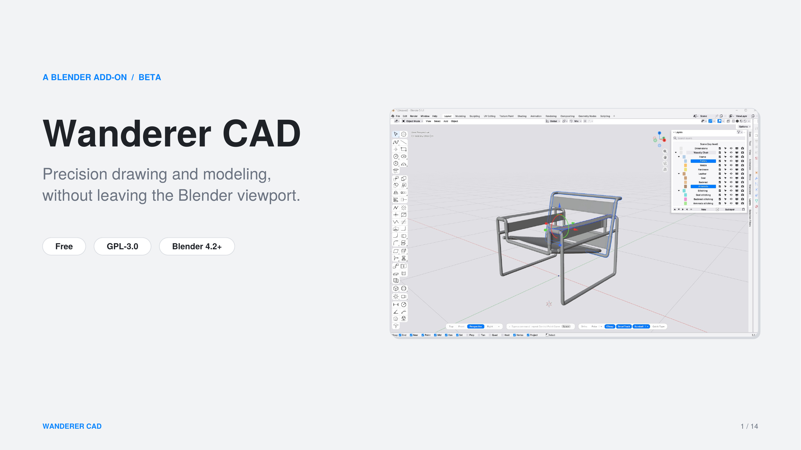

# Wanderer CAD

Precision drawing and modeling tools for Blender, with a workflow that feels familiar if you come from other CAD software: a command line, object snaps, tracking, dimensions and layers.

> **Status: beta.** Free and open source (GPL-3.0-or-later). Feedback and bug reports are very welcome.



## Features

- **Command line** at the bottom of the viewport: type a command name or an alias, then Enter or Space. Typed values (lengths, angles, coordinates) work with most tools.
- **Drawing**: polylines, control point curves, interpolated curves, rectangles, circles, ellipses, arcs, polygons, points, construction lines.
- **Curve editing**: join, explode, trim, split, divide, overkill, fillet, chamfer, extend, offset.
- **Transform**: move, copy, rotate, scale (reference points, 1D, 2D, to size), mirror, rectangular and polar arrays, align, stretch.
- **Surfaces and solids**: planar and edge surfaces, patch, extrude, revolve, loft, sweep, booleans, fillet and chamfer on edges, offset surface.
- **Precision**: object snaps (End, Near, Point, Mid, Cen, Int, Perp, Tan, Quad, Knot, Vertex), smart tracking, polar tracking.
- **Annotation**: linear and radius dimensions, area and length measurement, **Make 2D** drawings from a 3D model.
- **Layers** built on Blender collections: colors, sublayers, visibility and lock, saved layer states.
- **Groups**, **selection filters**, selection tools (select, box, circle, lasso), named view tabs and navigation presets.

| | |
|---|---|
|  |  |

## Installation

Requires **Blender 4.2 or newer**.

1. Download the latest `wanderer-x.y.z.zip` from the [Releases](../../releases) page.
2. In Blender: *Edit > Preferences > Get Extensions*, open the drop-down menu at the top right and choose **Install from Disk...**, then select the zip.
3. Enable **Wanderer CAD**. If you have an older version installed, remove it first and restart Blender.

## Build the zip yourself

```
python scripts/build_zip.py
```

The zip is written to `dist/`.

## Feedback

Please open an [issue](../../issues) with your Blender version, what you did and what you expected. Screenshots help.

## License

GPL-3.0-or-later. See [LICENSE](LICENSE).
