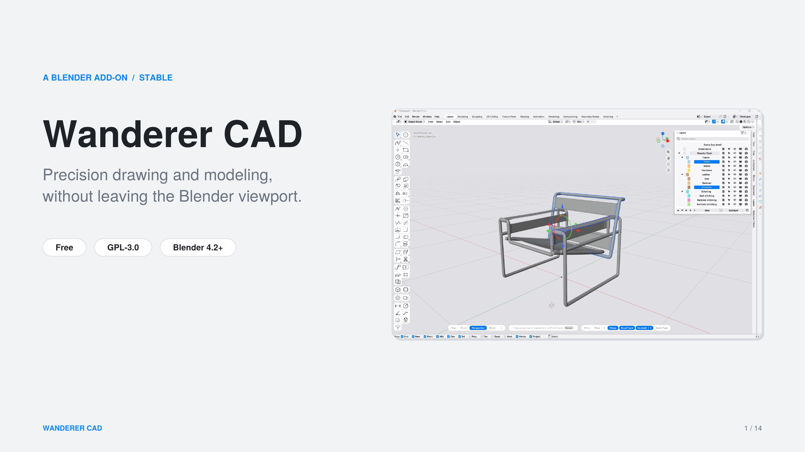
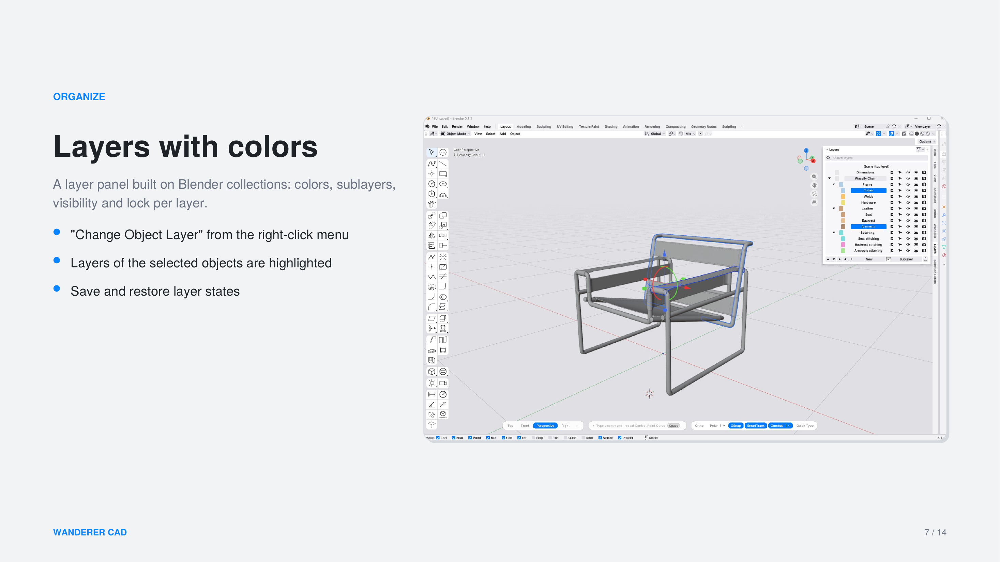
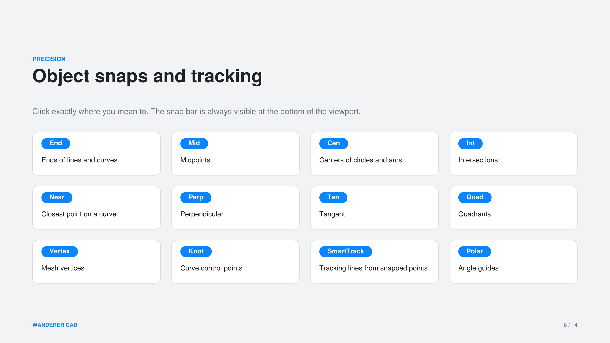

# Wanderer CAD

Precision drawing and modeling tools for Blender, with a workflow that feels familiar if you come from other CAD software: a command line, object snaps, tracking, dimensions, hatches, blocks and layers.

> **Status: stable (2.96.123).** Free and open source (GPL-3.0-or-later). Feedback and bug reports are very welcome.



## Features

- **Command line** at the bottom of the viewport: type a command name or an alias, then Enter or Space. Typed values (lengths, angles, coordinates) work with most tools.
- **Drawing**: polylines, control point curves, interpolated curves, rectangles, circles, ellipses, arcs, polygons, points, construction lines. `C` closes a curve, `F3` switches object snaps.
- **Curve editing**: join, explode, trim, split, divide, overkill, fillet, chamfer, extend, offset, rebuild, simplify, change degree, insert and remove control points, match and blend curves.
- **Transform**: move, copy, rotate, scale (reference points, 1D, 2D, to size), mirror, rectangular and polar arrays, align, stretch. Move, rotate and scale also work on curve points in Edit Mode.
- **Surfaces and solids**: planar, edge and network surfaces, patch, extrude (straight, along a curve, both sides, tapered, to a point), revolve, loft, sweep, booleans, PushPull, fillet and chamfer on edges and between surfaces, extend, split at isocurve, untrim, offset surface. Explode separates a solid into its smooth surfaces.
- **SubD**: boxes, spheres, cylinders, cones, tori and planes, loft, sweep, revolve and MultiPipe over a quad control cage, with cage editing tools (crease, insert edge, bevel, inset, bridge...) and live symmetry.
- **Precision**: object snaps (End, Near, Point, Mid, Cen, Int, Perp, Tan, Quad, Knot, Vertex), smart tracking, polar tracking. A snap budget keeps very large scenes responsive.
- **Annotation**: linear, continued / baseline, ordinate, radius, angle and arc length dimensions, center marks, text, area and length measurement, **Make 2D** drawings from a 3D model.
- **Hatches**: ten patterns with scale, rotation and spacing, hatch by picking a point, match, base point, boundary, explode.
- **Blocks**: make, insert, edit in place (every copy follows), explode, select copies.
- **Layers** built on Blender collections: colors, sublayers, visibility and lock, saved layer states.
- **Selection**: select, box, circle, lasso, selection filters, and `Ctrl/Cmd + Shift` sub-object selection (vertex, edge, face, or an area of points) straight into Edit Mode.
- **Groups**, named view tabs and navigation presets.
- **Mac**: `Cmd` acts as `Ctrl` in every gesture.
- **Look**: themes Blueprint, Vellum and Ghost; icon styles Atlas, Blueprint, Ochre and Target.

| | |
|---|---|
|  |  |

## Installation

Requires **Blender 4.2 or newer**. Developed and tested on Blender 5.1 and 5.2.

1. Download the latest `wanderer-x.y.z.zip` from the [Releases](../../releases) page.
2. In Blender: *Edit > Preferences > Get Extensions*, open the drop-down menu at the top right and choose **Install from Disk...**, then select the zip.
3. Enable **Wanderer CAD**. If you have an older version installed, remove it first and restart Blender.

## What changed

See [CHANGELOG.md](CHANGELOG.md).

## Build the zip yourself

```
python scripts/build_zip.py
```

The zip is written to `dist/`.

## Tests

The regression suites replay the tools in a headless Blender with the same mouse and keyboard events a user would send, and measure the result (coordinates, lengths, volumes, Undo / Redo states, timings).

```
pip install bpy numpy
python scripts/run_tests.py -j 4
```

See [tests/README.md](tests/README.md) for what each suite measures.

## Feedback

Please open an [issue](../../issues) with your Blender version, what you did and what you expected. Screenshots help.

## License

GPL-3.0-or-later. See [LICENSE](LICENSE).
